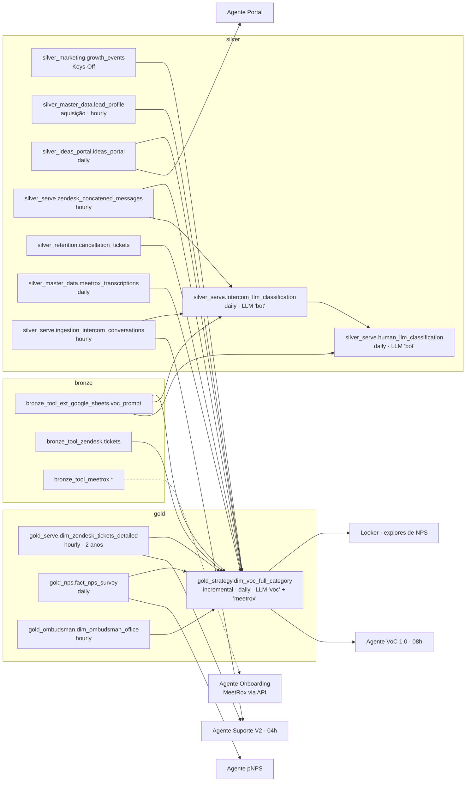
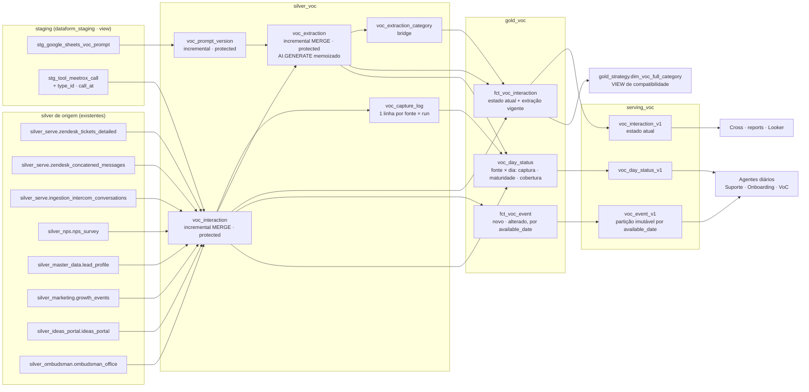

# Arquitetura das tabelas VoC no Dataform — idempotência e D-1 íntegro para os agentes

> **Escopo.** Proposta de arquitetura das tabelas de Voz do Cliente (VoC) no repositório `gcp-dataform-contaazul`, com dois requisitos centrais:
> 1. **Idempotência.** Reexecutar qualquer etapa (captura, classificação por LLM, publicação, run de agente) produz o mesmo resultado e não duplica, não perde e não paga LLM de novo.
> 2. **Dados íntegros até D-1** no horário das execuções programadas dos agentes do Sense.
>
> **Base.** Varredura do snapshot do repositório `gcp-dataform-contaazul` (zip de 21/10/2026, 1.340 arquivos) e medições read-only no BigQuery (`contaazul-ssbi`) feitas em 21/10/2026.
>
> **Relação com os outros documentos.** Detalha, para a camada de dados, as seções 2 e 6 da proposta "Sense - reformulação" (Notion) e o arquivo `sense-reformulacao-contexto.md`.

---

## 0. Resumo

**O que a varredura mostrou**

- **A `gold_strategy.dim_voc_full_category` não está pronta em D+1.** Ela roda todo dia por volta das 02h20 BRT, mas fica mudando por mais 8 dias. Para o dia 14/10, entre o retrato das 03h do dia 15 e o de hoje:
  - Zendesk: +10% de linhas;
  - aquisição: +109%;
  - NPS: tinha zero linhas às 03h do dia seguinte.

  Os agentes que leem às 04h e às 08h trabalham, portanto, com um D-1 incompleto.
- **O incremental usa uma janela única de 8 dias para todas as fontes e só insere.**
  - O que muda ou chega depois disso se perde. Exemplo: 11,9% dos leads perdidos entre jun e set nunca entraram na VoC.
  - O que é inserido fica congelado com o insumo do dia. Exemplo: 12,7% dos tickets do Zendesk foram classificados sem transcrição que hoje existe.
  - Falha de LLM nunca é reprocessada.
- **O próprio repositório já tem as peças da solução:**
  - o padrão de retry por `response.status` da `silver_serve.intercom_llm_classification`;
  - o contrato da camada `serving`;
  - o helper `data_freshness_assertions`;
  - as regras da `staging`;
  - os modelos remotos de embedding já declarados.

**O que a proposta faz**

1. **Captura por versão de conteúdo.** Uma tabela `silver_voc.voc_interaction` faz MERGE por chave natural e por `content_hash`, com janela de maturidade por fonte e fuso BRT único.
2. **Classificação memoizada.** Uma tabela `silver_voc.voc_extraction` usa como chave `hash(conteúdo, versão do prompt, modelo)`. Mesmo insumo, mesmo resultado, sem nova chamada. Falha vira status e é retentada com teto.
3. **Contrato de dia fechado.** Uma tabela `gold_voc.voc_day_status` diz, por fonte e por dia, se a captura fechou e se o dado está maduro.
4. **Publicação para agentes na `serving_voc`.** Uma partição imutável por "dia de disponibilidade" garante que o agente que processa D-1 sempre lê o mesmo conjunto, seja qual for o horário ou o número de reexecuções.
5. **Proteção contra custo e regressão.** `protected: true`, nenhum full refresh paga LLM, e a `dim_voc_full_category` vira view de compatibilidade.

---

## 1. Premissas e horários

### 1.1 Quem lê o quê, e quando

| Consumidor | Horário (BRT) | O que lê hoje | O que precisa estar íntegro |
|---|---|---|---|
| Dataform `dim_voc_full_category` (tag `daily`) | ~02h20 (medido pelo `last_modified_time` das partições) | Silver/gold das 7 fontes | — |
| Suporte V2 | 04h, diário (processa D-1) | `silver_serve.ingestion_intercom_conversations`, mensagens, `dim_zendesk_tickets_detailed` | Conversas de D-1 com `ai_issue_summary` |
| Onboarding | ~06h30, diário (D-1) | `gold_onboarding.*` + MeetRox via API (fora do BigQuery) | Reuniões de setup de D-1 |
| Orquestrador 1.0 (VoC 1.0) | 08h, diário | `gold_strategy.dim_voc_full_category` | Contagens de empresas por filtro, D-1 |
| pNPS | Quinzenal + fechamento mensal | `gold_nps.fact_nps_survey` | Mês fechado |
| Portal de Ideias | Mensal | `silver_ideas_portal.ideas_portal` + gold própria em `contaazul-ssbi.tmp_data_analytics` | Mês fechado |
| Cross / Report Mensal | Dia 4, 07h / 11h | Notion (sinais dos especialistas) | Mês fechado dos especialistas |
| Report Semanal | Segunda | OPs + `gold_strategy` | Semana fechada |

### 1.2 Definições usadas neste documento

- **Dia operacional:** dia civil em `America/Sao_Paulo`. Toda data de evento é BRT.
- **Captura fechada de D:** a ingestão de cada fonte já passou do fim de D (mais uma margem). Tudo que *existe* na origem com data D já está no lake.
- **Dado maduro de D:** passou a janela em que os atributos de um item de D costumam mudar (ticket resolvido, lead perdido, transcrição pronta, voto). Depois dela, mudanças são raras e tratadas como restatement explícito.
- **Dia de disponibilidade (`available_date`):** o dia operacional em que o item ficou disponível para os agentes.
  - Para o item que chegou no prazo, é a própria data do evento.
  - Para o que chegou atrasado ou mudou, é o dia que estava sendo fechado quando a mudança foi capturada.
  - É imutável depois de publicado.
- **Idempotência:** reexecutar com o mesmo estado de origem gera o mesmo estado de destino, sem duplicar linhas e sem nova chamada de LLM para insumo já classificado.

---

## 2. Diagnóstico do As-Is no Dataform

### 2.1 Linhagem atual



### 2.2 Como o incremental funciona hoje

Trecho relevante de `definitions/gold/strategy/tables/dim_voc_full_category.sqlx`:

- **Tipo e chave.** `type: "incremental"`, sem `uniqueKey`, ou seja, insert-only. O `updatePartitionFilter: "nk_event_date >= max_date"` não tem efeito sem MERGE.
- **Janela única.** `pre_operations` declara `max_date = DATETIME_TRUNC(MAX(nk_event_date), DAY) − 8 dias`, uma janela só para todas as fontes, calculada sobre a própria tabela. No full refresh, `max_date = 2025-01-01`.
- **Filtro de cada fonte.** `> max_date AND < CURRENT_DATE()`. O `CURRENT_DATE()` é UTC. Exceção: o portal de ideias usa `< CURRENT_DATETIME()`, também UTC, e inclui o dia corrente.
- **Dedupe.** `NOT EXISTS` contra `${self()}` por `(source, id_ferramenta)`, aplicado duas vezes (Zendesk e união).
- **Chamadas ao LLM.** `AI.GENERATE` com `gemini-3.1-flash-lite` em duas: resumo MeetRox e classificação VoC.
- **Saída.** Uma linha por categoria devolvida. Quando o retorno não bate com a lista: `COALESCE(cc.cat, 'Não é possível determinar')`.
- **Prompt.** Última linha da planilha `voc_prompt` por `dt_atualizacao`, lida direto do bronze.

### 2.3 Achados medidos

| # | Achado | Evidência (BigQuery, 21/10/2026) | Consequência para os agentes |
|---|---|---|---|
| 1 | **D-1 incompleto no horário dos agentes** | Evento de 14/10, retrato de 15/10 às 03h BRT (time travel) × hoje: Zendesk 1.072 → 1.182 (+10%), aquisição 76 → 159 (+109%), NPS 0 → 41; Keys-Off, ideias e Reclame Aqui iguais | O VoC 1.0 (08h) e qualquer leitura de D-1 subcontam, de forma diferente por fonte e por dia |
| 2 | **Partições mudam por até 8 dias** | `INFORMATION_SCHEMA.PARTITIONS`: as partições de 13/10 a 20/10 foram todas modificadas no run de 21/10 | O mesmo D-1 lido em dias diferentes dá números diferentes: não há reprodutibilidade |
| 3 | **Perda permanente fora da janela de 8 dias (aquisição)** | Leads perdidos criados de jun a set: 22.824 elegíveis, 2.725 ausentes (11,9%). O evento usa `created_at`, mas o lead vira "perdido" dias ou semanas depois | Motivo de perda subnotificado, de forma sistemática |
| 4 | **Perda permanente fora da janela (Zendesk)** | Tickets elegíveis de jun a set: 104.858, com 124 ausentes (0,12%); 122 deles resolvidos mais de 8 dias depois da abertura | Pequena, mas silenciosa |
| 5 | **Item congelado com insumo incompleto** | Linhas Zendesk de jun a set (104.761): 28.845 classificadas sem transcrição, das quais **13.328 hoje têm conversa** (12,7% do total). 3.801 (3,6%) receberam a solução depois. 12.121 (11,6%) tiveram o problema alterado depois | Classificação e resumo piores do que o dado permite, sem caminho de correção |
| 6 | **Falha de LLM nunca é retentada** | Desde jul: 140.478 itens enviados ao LLM, 79 sem nenhuma resposta e 15.326 (10,9%) indeterminados. O `NOT EXISTS` impede retry, e o `COALESCE` mascara erro como "indeterminado" | Erro de API vira rótulo permanente |
| 7 | **Insert-only permite duplicata em concorrência** | Desde jan: 6 chaves com linha repetida e 1 chave com duas classificações divergentes | Raro, mas mostra que a garantia é procedural (NOT EXISTS), não estrutural (MERGE) |
| 8 | **Janela única acopla as fontes** | `max_date` é o MAX de todas as fontes juntas; o portal de ideias inclui o dia corrente | Se uma fonte atrasar mais de 8 dias enquanto outra avança, o atraso vira perda |
| 9 | **Fuso inconsistente** | `CURRENT_DATE()` UTC como corte; `ideas_portal.created` convertido de `...Z` sem passar para BRT (as demais fontes estão em BRT) | Corte certo só porque o run cai de madrugada. Ideias com data deslocada em até 3h |
| 10 | **Chave do NPS não é global** | `id_ferramenta = nk_answer`, e a própria `fact_nps_survey` documenta que `nk_answer` não é único entre ferramentas (a chave é `sk_nps_survey`). Hoje: 0 colisões em 68.712 respostas | Risco latente: uma resposta nova pode ser descartada pelo NOT EXISTS |
| 11 | **Gold lendo bronze** | `voc_prompt` e `bronze_tool_zendesk.tickets` lidos direto pela gold | Viola a regra da `definitions/staging/README.md` ("Só a staging lê bronze") |
| 12 | **Sem `protected`, sem assertions** | Nenhum `assertions {}` no `config`; um full refresh reclassifica desde 2025-01-01 | Um clique pode custar ~US$ 1,9 mil em LLM e reescrever o histórico com outro prompt |
| 13 | **Dependência de fonte com retenção limitada** | `dim_zendesk_tickets_detailed` mantém só 2 anos (`metric_date >= CURRENT_DATE() − 2 anos`) | Um full refresh futuro perde o histórico de tickets mais antigos |
| 14 | **Fonte do Onboarding fora do lake** | `silver_master_data.meetrox_transcriptions` não tem o tipo da reunião (`type.id`) nem a data da chamada; o agente usa a API MeetRox | O Onboarding não consegue ler do BigQuery nem herdar as garantias do lake |
| 15 | **Gold do Portal fora do Dataform** | `contaazul-ssbi.tmp_data_analytics.sense_ideas_portal_*` (o `.coderabbit.yaml` proíbe referenciar `contaazul-ssbi` e o prefixo `tmp_`) | Estado de um agente fora do controle de versão e das assertions do lake |

**O que está bem e não precisa mudar:** a Intercom está completa às 04h. As conversas de 15/10 no retrato de 16/10 às 04h BRT (2.371 conversas, 1.834 com resumo) são idênticas às de hoje. A fonte do Suporte V2 já é estável no horário do agente.

**Corrupção do `ai_issue_summary`:** a Dataform só extrai o atributo (`JSON_VALUE(conversations.data, '$.custom_attributes."AI Issue summary"')`). A remoção do "ca" acontece antes, no atributo gravado no Intercom. A correção é no fluxo do Intercom, não no SQL.

### 2.4 O que já existe no repositório e deve ser reaproveitado

| Peça | Onde | Uso na proposta |
|---|---|---|
| Retry de LLM por `response.status` com janela de 7 dias e MERGE por `uniqueKey` | `silver/serve/tables/intercom/intercom_llm_classification.sqlx` | Modelo de base para `voc_extraction`, acrescido da chave por conteúdo |
| Contrato da camada serving: versão no nome, `published_at`, CAST explícito, `rowConditions`, `assertVolumeDrop`/`assertColumnContract`/`assertVolumeGrowth`, freshness, runbooks | `definitions/serving/README.md`, `includes/serving_assertions.js` | Os agentes passam a ser consumidores da `serving_voc` |
| Helper de freshness com `timeZone`, `ignoreHours`, `failWhenEmpty`, `dependOnTable` | `includes/data_freshness_assertions.js` | Freshness por fonte e da publicação |
| Regras da staging: só ela lê bronze, converte para BRT, uma por origem | `definitions/staging/README.md` | Prompt (planilha) e MeetRox entram por staging |
| Modelos remotos de embedding (`gemini-embedding-001`, `text-multilingual-embedding-002`, `text-embedding-005`) em `${constants.DS_DATABASE}.llm` | `definitions/external_dependencies.js` | Camada de embedding futura (fora do escopo deste documento) |
| Padrão de fonte congelada (`legacy`) só no full refresh | `definitions/staging/README.md` | Histórico anterior a 2025 e fontes descontinuadas |
| Regras do CodeRabbit (CTEs, `nk_`, snake_case, sem `contaazul-ssbi`) | `.coderabbit.yaml` | Convenções dos modelos novos |

---

## 3. Princípios de design

| # | Princípio | Como se traduz no Dataform |
|---|---|---|
| P1 | **Chave determinística por item e por versão** | `nk_voc_id = TO_HEX(SHA256(source ‖ chave natural))`; `content_hash = SHA256` dos campos que entram no prompt |
| P2 | **Janela de reprocessamento por fonte, guiada por mudança** | Cada fonte tem `maturity_days` e uma coluna de mudança (`source_updated_at`). A captura relê só o que mudou dentro da janela da fonte, não "os últimos N dias de evento de todas" |
| P3 | **MERGE, nunca insert-only** | `uniqueKey` em toda tabela incremental. A concorrência não duplica |
| P4 | **Inferência memoizada** | Chave da extração = `hash(content_hash, prompt_version, modelo)`. Reexecutar não chama o LLM para chave já resolvida com sucesso |
| P5 | **Falha é estado, não rótulo** | `extraction_status ∈ {ok, api_error, invalid_json, invalid_label, skipped}`, com `attempts`. Só `ok` alimenta os consumidores |
| P6 | **Fuso único na borda** | Conversão para `America/Sao_Paulo` só na staging ou na silver de origem. Todo corte usa `CURRENT_DATE('America/Sao_Paulo')` |
| P7 | **Separar captura, maturidade e publicação** | Os agentes nunca leem tabela de trabalho. Leem a `serving_voc`, publicada só depois do gate de dia fechado |
| P8 | **Partição publicada é imutável** | A publicação por `available_date` não reescreve dia já publicado. Correção tardia entra como evento novo no dia em que foi capturada |
| P9 | **Fail-closed na publicação** | Fonte obrigatória sem captura fechada bloqueia a publicação do dia (ou publica com `is_complete = false`, conforme a política da fonte). O agente decide pela flag, não por inferência |
| P10 | **Nenhum full refresh paga LLM** | `protected: true` nas tabelas de captura e de extração. Reclassificação histórica só por variável explícita (`voc_backfill_from`) e com teto (`voc_max_llm_items`) |
| P11 | **Rastreabilidade de execução** | Toda linha publicada tem `published_at` (BRT) e `nk_publication_id`. O agente grava esse id no log e, ao reexecutar, lê a mesma publicação |

---

## 4. Arquitetura proposta

### 4.1 Camadas e modelos



**Hierarquia.** A `silver_voc` lê apenas silver de origem e staging. Por isso a captura do Zendesk usa `silver_serve.zendesk_tickets_detailed`, e não a `gold_serve.dim_zendesk_tickets_detailed`; e o NPS usa `silver_nps.nps_survey`, e não a gold. Isso respeita a regra do CodeRabbit (silver não lê gold). Antes da implementação, é preciso confirmar que as silver de origem têm todas as colunas usadas hoje.

### 4.2 Especificação dos modelos

| Modelo | Tipo | Grão / chave | Partição · cluster | Estratégia incremental | Tags / cadência |
|---|---|---|---|---|---|
| `dataform_staging.stg_google_sheets_voc_prompt` | view | 1 linha por (local_uso, dt_atualizacao) | — | — | `staging_google_sheets`, `daily` |
| `dataform_staging.stg_tool_meetrox_call` | view | 1 linha por `nk_call_id` | — | — | `staging_meetrox`, `daily` |
| `silver_voc.voc_prompt_version` | incremental, `protected` | 1 linha por `nk_prompt_version_id = hash(local_uso, prompt)` | — | MERGE; nunca apaga; `is_valid` vem das validações da lista de categorias | `silver_voc`, `daily` |
| `silver_voc.voc_interaction` | incremental, `protected` | 1 linha por `nk_voc_id` (versão corrente) | `event_date` (dia) · `source`, `nk_company_id` | MERGE por `nk_voc_id`, só para linhas com `content_hash` novo ou alterado, dentro da janela da fonte | `silver_voc`, `daily`, `voc_capture` |
| `silver_voc.voc_capture_log` | incremental | 1 linha por (`nk_run_id`, source) | `run_date` | MERGE por (`nk_run_id`, source) | `silver_voc`, `daily` |
| `silver_voc.voc_extraction` | incremental, `protected` | 1 linha por `nk_extraction_id = hash(nk_voc_id, content_hash, nk_prompt_version_id, model_id)` | `extracted_date` · `source`, `extraction_status` | MERGE; candidatos = chaves sem `ok` e com `attempts < 3`; teto por run | `silver_voc`, `daily`, `voc_extraction` |
| `silver_voc.voc_extraction_category` | incremental | 1 linha por (`nk_extraction_id`, `nk_category_id`) | `extracted_date` | MERGE pela chave composta | `silver_voc`, `daily` |
| `gold_voc.fct_voc_interaction` | table | 1 linha por `nk_voc_id` com a extração `ok` do `content_hash` vigente | `event_date` · `source` | Reconstruída a cada run (barata: join de duas tabelas) | `gold_voc`, `daily` |
| `gold_voc.fct_voc_event` | incremental | 1 linha por (`nk_voc_id`, `content_hash`) com `available_date` e `event_type ∈ {novo, alterado}` | `available_date` · `source` | MERGE com `updatePartitionFilter: available_date >= run_date − 1`; partições anteriores nunca são tocadas | `gold_voc`, `daily` |
| `gold_voc.voc_day_status` | table | 1 linha por (source, event_date) nos últimos 60 dias | `event_date` | Reconstruída a cada run | `gold_voc`, `daily` |
| `serving_voc.voc_event_v1` | incremental (publicação) | 1 linha por (`available_date`, `nk_voc_id`, `content_hash`) | `available_date` · `source` | Publica só `available_date = D-1` e só se o gate passou; reexecução no mesmo dia substitui a mesma partição | `serving_voc`, `daily` |
| `serving_voc.voc_interaction_v1` | table | 1 linha por `nk_voc_id` | `event_date` · `source` | Substituição atômica, com guardas da serving | `serving_voc`, `daily` |
| `serving_voc.voc_day_status_v1` | table | 1 linha por (source, event_date) | `event_date` | Substituição atômica | `serving_voc`, `daily` |
| `gold_strategy.dim_voc_full_category` | view | O grão atual (item × categoria) | — | View sobre `fct_voc_interaction` + bridge, com as mesmas colunas | `gold_strategy`, `daily` |

### 4.3 Colunas-chave da `silver_voc.voc_interaction`

| Coluna | Tipo | Regra |
|---|---|---|
| `nk_voc_id` | STRING | `TO_HEX(SHA256(CONCAT(source, '|', nk_source_record_id)))` |
| `source` | STRING | `zendesk`, `intercom`, `nps`, `aquisicao`, `keys_off`, `ideas_portal`, `reclame_aqui`, `meetrox_onboarding` (valores travados por `rowConditions`) |
| `nk_source_record_id` | STRING | Chave natural da origem. **NPS = `sk_nps_survey`**, não `nk_answer` |
| `event_at` / `event_date` | DATETIME / DATE (BRT) | Momento em que a voz do cliente aconteceu, conforme a fonte (ver 6.2). **Aquisição = data da perda**, não a criação do lead |
| `source_updated_at` | DATETIME (BRT) | Última alteração do registro na origem; dirige a releitura dentro da janela |
| `nk_company_id`, `nk_accountancy_id`, `customer_type` | — | Mesma semântica da `dim_voc_full_category`, mais o perfil de quem fala (Parceiro, Cliente do Parceiro, Cliente sem Parceiro) |
| `title`, `reason`, `sub_reason`, `problem_details`, `transcription`, `meetrox_summary`, `category_source`, `subcategory_source`, `ticket_type` | STRING | Insumo textual, normalizado como hoje (vazios equivalentes viram NULL) |
| `content_hash` | STRING | `SHA256` só dos campos que entram no prompt, na ordem do bloco `<CNTX>`. Mudança de outros campos não dispara reclassificação |
| `prompt_values`, `has_info` | STRING, BOOL | Bloco `<CNTX>` montado como hoje e a flag de insumo. Gerados pela própria `voc_interaction` para a extração não remontar o texto (omitidos no esboço 7.1) |
| `first_seen_at` | DATETIME (BRT) | Preservado no MERGE: `COALESCE(atual.first_seen_at, CURRENT_DATETIME('America/Sao_Paulo'))` |
| `last_changed_at` | DATETIME (BRT) | Atualizado só quando o `content_hash` muda |
| `is_mature` | BOOL | `CURRENT_DATE('America/Sao_Paulo') − event_date > maturity_days(source)` |
| `nk_run_id` | STRING | Id da execução que gravou a versão corrente |

---

## 5. Idempotência por camada

| Camada | Mecanismo | Reexecutar no mesmo dia | Reexecutar depois de falha parcial | Full refresh |
|---|---|---|---|---|
| Staging (views) | Determinística, sem estado | Mesmo resultado | — | — |
| `voc_prompt_version` | MERGE por hash do prompt | Nenhuma linha nova se a planilha não mudou | — | Bloqueado (`protected`) |
| `voc_interaction` | MERGE por `nk_voc_id`; a fonte só emite linhas com `content_hash` diferente do gravado; `first_seen_at` preservado | Zero linhas alteradas | Retoma: o que não foi gravado continua com hash diferente | Bloqueado. O histórico além da retenção das fontes (ex.: 2 anos do Zendesk) só existe aqui |
| `voc_extraction` | Chave = conteúdo × prompt × modelo; candidatos = chaves sem `ok`; MERGE com `attempts + 1` | Zero chamadas de LLM | Só chama o LLM para o que faltou ou falhou, até `attempts = 3` | Bloqueado. Reclassificar exige `voc_backfill_from` + teto `voc_max_llm_items` |
| `fct_voc_event` | MERGE só na partição `available_date = D-1` | Substitui a própria partição com o mesmo conteúdo | Idem | Recalculável a partir da `voc_interaction` sem LLM (o `available_date` dos eventos antigos é reconstruído por `first_seen_at` e `last_changed_at`) |
| `serving_voc.voc_event_v1` | Publica só a partição do dia, depois do gate | Mesmo conteúdo | Idem | Rebuild a partir da gold, sem LLM |
| Agente | Lê `available_date = D-1` e grava o `nk_publication_id` no log | Mesmo insumo | Mesmo insumo | — |

**Detalhes que fazem a diferença:**

1. **MERGE com `updatePartitionFilter` exige coerência.** O filtro limita as partições do destino que o MERGE enxerga. Se uma linha de origem tiver `event_date` fora desse intervalo, o MERGE não acha a linha existente e **insere duplicata**. Por isso a CTE de origem filtra `event_date >= reprocess_from`, com o mesmo `reprocess_from` declarado no `pre_operations`. Esse limite é o maior `maturity_days` entre as fontes, mais uma margem.
2. **Memoização é o que torna o LLM idempotente.** `temperature: 0` e `thinking_budget: 0` reduzem, mas não eliminam, a variação do Gemini entre chamadas. Quem garante "mesmo insumo, mesma resposta" é não chamar de novo.
3. **Troca de prompt não reclassifica o passado sozinha.** Quando o `nk_prompt_version_id` vigente muda:
   - itens novos e alterados usam o prompt novo;
   - itens antigos mantêm a extração anterior, com o prompt registrado na linha.

   A reclassificação histórica é uma operação explícita, com estimativa de custo antes.
4. **Prompt inválido não derruba a classificação.** `voc_prompt_version.is_valid` exige:
   - lista `<SUBCATEGORIA>` não vazia;
   - nomes únicos e sem ":";
   - quantidade dentro de uma faixa esperada.

   A extração sempre usa a última versão válida. Hoje, uma edição errada na planilha chega direto à produção no dia seguinte.
5. **Concorrência.** O `uniqueKey` resolve duplicata entre runs simultâneos. O workflow da VoC deve rodar em série (uma configuração de workflow só, sem execuções sobrepostas da mesma tag).

---

## 6. D-1 íntegro: o contrato de dia fechado

### 6.1 Dois relógios por fonte

- **Captura:** "o que existe na origem com data D já chegou ao lake?" Medida pelo watermark da ingestão da fonte: maior `source_updated_at`, ou maior data de ingestão no bronze, ≥ fim de D + margem.
- **Maturidade:** "os atributos dos itens de D ainda costumam mudar?" Medida pela janela da fonte. Depois dela, uma mudança vira restatement explícito.

Os agentes diários precisam de **captura fechada**. As leituras mensais (Cross, pNPS de fechamento, reports) precisam de **maturidade**.

### 6.2 Regras por fonte

As janelas iniciais vêm das medições e devem ser recalibradas com a query do apêndice A.4.

| Fonte | `event_at` (BRT) | O que muda depois | Captura fechada de D quando | `maturity_days` inicial | Evidência |
|---|---|---|---|---|---|
| Intercom (Suporte) | `created_at` da conversa | `ai_issue_summary`, estado de resolução | Ingestão horária com `updated_at` ≥ D+1 01h | 1 | Retrato de D+1 04h igual ao de hoje (15/10) |
| Zendesk | Abertura do ticket (`metric_date`) | Categoria, nível, solução, problema, transcrição | `silver_serve.zendesk_tickets_detailed` com `source_updated_at` ≥ D+1 01h | 15 | +10% de linhas após D+1; 11,6% com problema alterado; 12,7% com transcrição tardia; 3,2% resolvidos após 8 dias |
| NPS | Coleta da resposta (`nk_date`) | Ticket vinculado, ações | Freshness da Survicate (o repo já usa 3 dias) e `nk_date` máximo ≥ D | 7 | 0 linhas de 14/10 às 03h do dia 15; 41 depois |
| Aquisição | **Data da perda** (`lead_status_date` quando o status é "Fechado - Perdido"; senão, a primeira vez que `lost_reason` aparece) | Motivo e submotivo | `lead_profile` horária com `updated_at` ≥ D+1 01h | 2 | 11,9% perdidos hoje por usar `created_at` + janela de 8 dias |
| Keys-Off | `event_date` do formulário | Nada | `growth_events` com data ≥ D | 1 | Igual entre D+1 e D+7 |
| Portal de Ideias | `created` **convertido para BRT** | Votos, status (texto estável) | Ingestão diária com data ≥ D | 1 (texto); votos em snapshot mensal à parte | Igual entre D+1 e D+7 |
| Reclame Aqui | Primeira data do ticket-pai | Tickets-filhos e descrição | Ouvidoria horária com `updated_at` ≥ D+1 01h | 15 | Agrupamento por ticket-pai recebe filhos depois |
| MeetRox (Onboarding) | Data da chamada (coluna a criar na staging) | Transcrição pronta, tipo da reunião | Bronze MeetRox com `updated_at` ≥ D+1 01h | 3 | O agente hoje lê pela API; a coluna de tipo não existe na silver |

### 6.3 `gold_voc.voc_day_status`

Uma linha por (source, event_date) nos últimos 60 dias:

| Coluna | Regra |
|---|---|
| `captured_until` | Watermark da fonte no run, tirado da `voc_capture_log` |
| `is_capture_closed` | `captured_until >= DATETIME(event_date + 1, '01:00')` |
| `is_mature` | `CURRENT_DATE('America/Sao_Paulo') − event_date > maturity_days` |
| `items`, `items_changed_today` | Volume vigente e alterações do run |
| `extraction_coverage` | Itens com extração `ok` do hash vigente ÷ itens com insumo |
| `expected_items` | Mediana das últimas 8 ocorrências do mesmo dia da semana (fins de semana e feriados se comparam entre si, como a regra do Suporte V2) |
| `volume_anomaly` | `items < 0.5 × expected_items` com captura fechada (alerta, não bloqueio) |
| `day_state` | `aberto`, `captura_fechada` ou `maduro` |

### 6.4 Publicação diária para agentes: `serving_voc.voc_event_v1`

- **Grão:** um evento por versão de conteúdo de um item.
  - `event_type = novo`: primeira vez que o item aparece.
  - `event_type = alterado`: o conteúdo que entra no prompt mudou dentro da janela de maturidade.
- **`available_date`:**
  - `= event_date`, se o item foi capturado no run que fechou o próprio dia;
  - senão, `= run_date − 1` (o dia que estava sendo fechado quando a novidade chegou).
- **Imutabilidade:** cada run publica **só** a partição `available_date = run_date − 1`. As partições anteriores nunca são reescritas.
- **Consequência para o agente:** o agente que processa D-1 lê `WHERE available_date = D-1`. Rodando às 04h, às 10h ou reexecutando três dias depois, recebe exatamente o mesmo conjunto: os eventos novos de D-1 mais as novidades tardias capturadas naquela noite. Nada é contado duas vezes nem perdido entre dois dias.
- **Gate:** a partição de D-1 só é publicada se, para cada fonte com `required_for_daily = true`, `voc_day_status.is_capture_closed` for verdadeiro para D-1.
  - Fontes obrigatórias no diário: Intercom e Zendesk.
  - NPS e aquisição ficam como não obrigatórias, porque têm atraso conhecido. Seus eventos chegam no dia em que forem capturados, com `event_type = novo` e `event_date` antigo, e o agente conta pelo dia em que ficaram disponíveis.
- **Colunas de contrato** (padrão da serving):
  - `published_at` (DATETIME BRT) e `nk_publication_id`;
  - `is_late_arrival` (quando `event_date < available_date`);
  - toda a extração vigente: `extraction_status`, categorias, natureza e sentimento.

### 6.5 Estado atual para leituras mensais: `serving_voc.voc_interaction_v1`

- Uma linha por item, com a extração `ok` do `content_hash` vigente, `is_mature` e `day_state`.
- O Cross, o fechamento do pNPS e os reports devem filtrar `is_mature = true` para os meses que fecham. O VoC 1.0 e o Looker leem esta tabela (ou a view de compatibilidade).

### 6.6 Como cada agente consome

| Agente | Tabela | Filtro | Gate antes de processar |
|---|---|---|---|
| Suporte V2 (04h) | `serving_voc.voc_event_v1` (source = intercom, mais o join com Zendesk que já está no item) | `available_date = processing_date` | `voc_day_status_v1`: intercom e zendesk com `is_capture_closed` para `processing_date`; senão, aborta com a mensagem padrão da família e tenta de novo no próximo agendamento |
| Onboarding (06h30) | `serving_voc.voc_event_v1` (source = meetrox_onboarding), depois da staging MeetRox | `available_date = processing_date` | Captura do MeetRox fechada |
| VoC 1.0 (08h) | `serving_voc.voc_interaction_v1` | Filtros das OPs | `published_at` do dia; `is_mature` para métricas de tendência |
| pNPS (fechamento) | `serving_voc.voc_interaction_v1` (source = nps) | Mês de `event_date` | Todos os dias do mês com `day_state = maduro` |
| Portal (mensal) | `serving_voc.voc_interaction_v1` (source = ideas_portal) e um snapshot de votos dentro do Dataform | Mês fechado | Captura do mês fechada |
| Cross / reports | `serving_voc.voc_interaction_v1` + marts | Mês fechado | Mês maduro |

### 6.7 Encadeamento de horários

| Horário (BRT) | Etapa | Observação |
|---|---|---|
| Contínuo | Ingestões e silver horárias (Zendesk, Intercom, leads, ouvidoria) | Já existem |
| 01h30 | Workflow `voc_daily`: captura (`voc_interaction`, `voc_capture_log`) | Depois de a hora de 01h das silver horárias fechar D-1 |
| 01h45–03h00 | Extração (`voc_extraction`), com teto por run | Hoje o run inteiro leva ~minutos; o teto evita que um backlog atrase a publicação |
| 03h10 | `voc_day_status`, `fct_voc_event`, `fct_voc_interaction` | — |
| 03h20 | Publicação `serving_voc` (gate + guardas) | Freshness da serving com `ignoreHours` cobrindo 00h–04h |
| 04h00 | Suporte V2 | Lê D-1 publicado |
| 06h30 | Onboarding | — |
| 08h00 | Orquestrador 1.0 | — |

A agenda do Dataform fica na console (workflow configs), fora do repositório. O que muda nela:
- uma configuração `voc_daily` por tag `voc_capture`/`voc_extraction` às 01h30;
- uma configuração `serving_voc` às 03h20, com `dependOnDependencyAssertions` ligado.

---

## 7. Esboço dos modelos

Os esboços seguem as convenções do repositório: CTEs, `nk_`, snake_case, `${ref()}`, sem comentário de linha no corpo (regra do CodeRabbit). As descrições de colunas foram abreviadas.

### 7.1 `silver_voc.voc_interaction` (trecho com Zendesk e aquisição)

```sql
config {
    type: "incremental",
    schema: "silver_voc",
    name: "voc_interaction",
    tags: ["silver_voc", "daily", "voc_capture", "voc_interaction"],
    protected: true,
    uniqueKey: ["nk_voc_id"],
    description: "Uma linha por item de voz do cliente (versão vigente). Grão: source + nk_source_record_id. MERGE só quando o content_hash muda, dentro da janela de maturidade da fonte.",
    bigquery: {
        partitionBy: "event_date",
        clusterBy: ["source", "nk_company_id"],
        updatePartitionFilter: "event_date >= reprocess_from"
    },
    assertions: {
        uniqueKey: ["nk_voc_id"],
        nonNull: ["nk_voc_id", "source", "nk_source_record_id", "event_date", "content_hash", "first_seen_at"],
        rowConditions: [
            "source IN ('zendesk', 'intercom', 'nps', 'aquisicao', 'keys_off', 'ideas_portal', 'reclame_aqui', 'meetrox_onboarding')",
            "event_date <= CURRENT_DATE('America/Sao_Paulo')"
        ]
    },
    columns: { nk_voc_id: "...", source: "...", content_hash: "..." }
}

WITH
  zendesk AS (
    SELECT
      'zendesk' AS source,
      CAST(t.id AS STRING) AS nk_source_record_id,
      t.metric_date AS event_at,
      t.source_updated_at AS source_updated_at,
      t.contaazul_company_id AS nk_company_id,
      t.problem AS reason,
      t.solution AS sub_reason,
      t.problem_details AS problem_details,
      c.total_conversation AS transcription
    FROM ${ref('silver_serve', 'zendesk_tickets_detailed')} AS t
    LEFT JOIN ${ref('silver_serve', 'zendesk_concatened_messages')} AS c
      ON c.ticket_id = t.id
    WHERE DATE(t.metric_date) >= GREATEST(reprocess_from, DATE_SUB(run_date, INTERVAL 15 DAY))
      AND DATE(t.metric_date) < run_date
      AND t.ticket_level IS NOT NULL
      AND t.ticket_category IS NOT NULL
  ),
  aquisicao AS (
    SELECT
      'aquisicao' AS source,
      CAST(l.id AS STRING) AS nk_source_record_id,
      COALESCE(l.lead_status_date, l.updated_at) AS event_at,
      l.updated_at AS source_updated_at,
      l.contaazul_company_id AS nk_company_id,
      l.lost_reason AS reason,
      l.sub_lost_reason AS sub_reason,
      CAST(NULL AS STRING) AS problem_details,
      CAST(NULL AS STRING) AS transcription
    FROM ${ref('silver_master_data', 'lead_profile')} AS l
    WHERE (l.lead_status = 'Fechado - Perdido' OR l.lost_reason IS NOT NULL)
      AND DATE(COALESCE(l.lead_status_date, l.updated_at)) >= GREATEST(reprocess_from, DATE_SUB(run_date, INTERVAL 2 DAY))
      AND DATE(COALESCE(l.lead_status_date, l.updated_at)) < run_date
  ),
  unioned AS (
    SELECT * FROM zendesk
    UNION ALL
    SELECT * FROM aquisicao
  ),
  hashed AS (
    SELECT
      TO_HEX(SHA256(CONCAT(source, '|', nk_source_record_id))) AS nk_voc_id,
      unioned.*,
      DATE(event_at) AS event_date,
      TO_HEX(SHA256(CONCAT(
        IFNULL(reason, ''), '|', IFNULL(sub_reason, ''), '|',
        IFNULL(problem_details, ''), '|', IFNULL(transcription, '')
      ))) AS content_hash
    FROM unioned
  ),
  current_state AS (
    SELECT nk_voc_id, content_hash, first_seen_at
    FROM ${self()}
    WHERE event_date >= reprocess_from
  ),
  changed AS (
    SELECT
      hashed.*,
      COALESCE(current_state.first_seen_at, CURRENT_DATETIME('America/Sao_Paulo')) AS first_seen_at,
      CURRENT_DATETIME('America/Sao_Paulo') AS last_changed_at,
      run_id AS nk_run_id
    FROM hashed
    LEFT JOIN current_state USING (nk_voc_id)
    WHERE current_state.nk_voc_id IS NULL
      OR current_state.content_hash != hashed.content_hash
  )
SELECT * FROM changed

pre_operations {
  DECLARE run_date DATE DEFAULT CURRENT_DATE('America/Sao_Paulo');
  DECLARE reprocess_from DATE DEFAULT ${when(incremental(),
    `DATE_SUB(CURRENT_DATE('America/Sao_Paulo'), INTERVAL 16 DAY)`,
    `DATE '2025-01-01'`)};
  DECLARE run_id STRING DEFAULT GENERATE_UUID();
}
```

Pontos de atenção do esboço:
- O `WHERE` de cada fonte usa `GREATEST(reprocess_from, run_date − maturity_days)`. Isso mantém toda linha de origem dentro das partições que o MERGE enxerga (ver 5, item 1).
- `< run_date` com `run_date = CURRENT_DATE('America/Sao_Paulo')` só captura dias fechados.
- `nk_run_id` precisa ser o mesmo em todos os modelos de um workflow. O `GENERATE_UUID()` acima é ilustrativo; na implementação, o id deve vir de uma `operations` no início do workflow que grava uma linha em `silver_voc.voc_capture_log` e é lida pelos demais modelos, ou da variável de compilação `dataform.projectConfig.vars`.
- Na janela de maturidade, o filtro de Zendesk por data de abertura cobre os casos medidos. Para tickets que mudam muito depois, o mesmo padrão pode usar `source_updated_at` como gatilho, com uma janela maior só para releitura de hash.

### 7.2 `silver_voc.voc_extraction` (memoização + retry + teto)

```sql
config {
    type: "incremental",
    schema: "silver_voc",
    name: "voc_extraction",
    tags: ["silver_voc", "daily", "voc_extraction"],
    protected: true,
    uniqueKey: ["nk_extraction_id"],
    description: "Uma linha por (item, versão de conteúdo, versão de prompt, modelo). A chamada ao LLM só acontece para chave sem resultado ok e com menos de 3 tentativas.",
    bigquery: {
        partitionBy: "extracted_date",
        clusterBy: ["source", "extraction_status"],
        updatePartitionFilter: "extracted_date >= retry_from"
    },
    assertions: {
        uniqueKey: ["nk_extraction_id"],
        nonNull: ["nk_extraction_id", "nk_voc_id", "content_hash", "nk_prompt_version_id", "extraction_status"],
        rowConditions: [
            "extraction_status IN ('ok', 'api_error', 'invalid_json', 'invalid_label', 'skipped')",
            "attempts BETWEEN 1 AND 3"
        ]
    },
    columns: { nk_extraction_id: "...", extraction_status: "..." }
}

WITH
  prompt AS (
    SELECT nk_prompt_version_id, prompt
    FROM ${ref('silver_voc', 'voc_prompt_version')}
    WHERE local_uso = 'voc' AND is_valid
    QUALIFY ROW_NUMBER() OVER (ORDER BY valid_from DESC) = 1
  ),
  candidates AS (
    SELECT
      i.nk_voc_id, i.source, i.content_hash, i.prompt_values, i.event_date,
      p.nk_prompt_version_id,
      TO_HEX(SHA256(CONCAT(i.nk_voc_id, '|', i.content_hash, '|', p.nk_prompt_version_id, '|', model_id))) AS nk_extraction_id
    FROM ${ref('silver_voc', 'voc_interaction')} AS i
    CROSS JOIN prompt AS p
    WHERE i.has_info
      AND (i.event_date >= retry_from OR i.event_date >= backfill_from)
  ),
  previous AS (
    SELECT nk_extraction_id, extraction_status, attempts
    FROM ${self()}
    WHERE extracted_date >= retry_from
  ),
  to_call AS (
    SELECT candidates.*, IFNULL(previous.attempts, 0) AS previous_attempts
    FROM candidates
    LEFT JOIN previous USING (nk_extraction_id)
    WHERE previous.nk_extraction_id IS NULL
      OR (previous.extraction_status != 'ok' AND previous.attempts < 3)
    QUALIFY ROW_NUMBER() OVER (ORDER BY event_date DESC, nk_voc_id) <= max_llm_items
  ),
  generated AS (
    SELECT
      to_call.*,
      AI.GENERATE(CONCAT(prompt.prompt, to_call.prompt_values),
        connection_id => 'us.vertex_connection',
        endpoint => 'https://aiplatform.googleapis.com/v1/projects/contaazul-datalake-prod/locations/global/publishers/google/models/gemini-3.1-flash-lite',
        model_params => JSON '{"labels":{"ca_initiative":"voc_v3","ca_application_name":"bigquery"},"generation_config":{"thinking_config":{"thinking_budget":0},"temperature":0.0,"maxOutputTokens":2000,"responseMimeType":"application/json"}}'
      ) AS response
    FROM to_call
    CROSS JOIN prompt
  ),
  parsed AS (
    SELECT
      generated.* EXCEPT (response),
      generated.response.status AS llm_status,
      COALESCE(REGEXP_EXTRACT(generated.response.result, r'(?s)\{.*\}'), generated.response.result) AS json_str
    FROM generated
  )
SELECT
  nk_extraction_id, nk_voc_id, source, content_hash, nk_prompt_version_id,
  CURRENT_DATE('America/Sao_Paulo') AS extracted_date,
  previous_attempts + 1 AS attempts,
  CASE
    WHEN llm_status != '' THEN 'api_error'
    WHEN SAFE.PARSE_JSON(json_str) IS NULL THEN 'invalid_json'
    ELSE 'ok'
  END AS extraction_status,
  llm_status,
  json_str AS raw_response,
  JSON_VALUE(json_str, '$.sentimento') AS sentiment,
  JSON_VALUE(json_str, '$.macrotema') AS macro_theme,
  JSON_VALUE(json_str, '$.Resumo_do_Incidente_gemini') AS incident_summary
FROM parsed

pre_operations {
  DECLARE retry_from DATE DEFAULT DATE_SUB(CURRENT_DATE('America/Sao_Paulo'), INTERVAL 16 DAY);
  DECLARE backfill_from DATE DEFAULT DATE '${dataform.projectConfig.vars.voc_backfill_from || "9999-12-31"}';
  DECLARE max_llm_items INT64 DEFAULT ${dataform.projectConfig.vars.voc_max_llm_items || 20000};
  DECLARE model_id STRING DEFAULT 'gemini-3.1-flash-lite';
}
```

Pontos de atenção do esboço:
- **Itens de fora da janela.** Uma extração `ok` de item que mudou fora da janela não é recriada, porque o item não volta a ser candidato. É o comportamento desejado: o maduro fica congelado.
- **`invalid_label`.** Sai de uma etapa seguinte, ao validar as categorias contra a versão do prompt em `voc_extraction_category`. Um item `ok` sem nenhuma categoria válida vira `invalid_label` e volta para retry.
- **Teto por run (`max_llm_items`).** Protege a publicação das 03h20 de um backlog inesperado (ex.: troca de prompt mal configurada). O excedente fica para o próximo run, e o `extraction_coverage` do `voc_day_status` mostra a pendência.
- **Formato da resposta.** `responseMimeType: application/json` reduz o `invalid_json`. Vale testar no `AI.GENERATE` antes de adotar.

### 7.3 Gate de publicação da `serving_voc.voc_event_v1`

```sql
config {
    type: "incremental",
    schema: "serving_voc",
    name: "voc_event_v1",
    tags: ["serving_voc", "daily", "voc_event_v1"],
    uniqueKey: ["available_date", "nk_voc_id", "content_hash"],
    dependOnDependencyAssertions: true,
    bigquery: {
        partitionBy: "available_date",
        clusterBy: ["source"],
        updatePartitionFilter: "available_date = publish_date",
        labels: { owner: "<pessoa_responsavel>", team: "sense" }
    },
    assertions: {
        uniqueKey: ["available_date", "nk_voc_id", "content_hash"],
        nonNull: ["available_date", "nk_voc_id", "source", "event_type", "published_at", "nk_publication_id"],
        rowConditions: ["event_type IN ('novo', 'alterado')", "available_date = publish_date OR available_date < publish_date"]
    },
    columns: { available_date: "...", published_at: "..." }
}

SELECT
  CAST(e.available_date AS DATE) AS available_date,
  CAST(e.nk_voc_id AS STRING) AS nk_voc_id,
  CAST(e.content_hash AS STRING) AS content_hash,
  CAST(e.source AS STRING) AS source,
  CAST(e.event_type AS STRING) AS event_type,
  CAST(e.event_date AS DATE) AS event_date,
  CAST(e.event_date < e.available_date AS BOOL) AS is_late_arrival,
  CURRENT_DATETIME('America/Sao_Paulo') AS published_at,
  CAST(publication_id AS STRING) AS nk_publication_id
FROM ${ref('gold_voc', 'fct_voc_event')} AS e
WHERE e.available_date = publish_date

pre_operations {
  DECLARE publish_date DATE DEFAULT DATE_SUB(CURRENT_DATE('America/Sao_Paulo'), INTERVAL 1 DAY);
  DECLARE publication_id STRING DEFAULT GENERATE_UUID();
  ASSERT (
    SELECT LOGICAL_AND(is_capture_closed)
    FROM ${ref('gold_voc', 'voc_day_status')}
    WHERE event_date = publish_date AND required_for_daily
  ) AS 'voc_event_v1: captura de D-1 não fechada para fonte obrigatória; publicação bloqueada';
}
```

Pontos de atenção do esboço:
- O `ASSERT` no `pre_operations` segue o padrão da serving ("antes de publicar, bloqueia"). Se a captura não fechou, a partição de D-1 não é escrita, e o agente encontra `voc_day_status_v1` com `captura_fechada = false` e aborta, sem processar dado parcial.
- `assertColumnContract` e `assertVolumeGrowth` entram no `post_operations`, como no `start_onboarding_v1`. O `assertVolumeDrop` não se aplica a uma tabela particionada por dia de publicação; o equivalente é o `volume_anomaly` do `voc_day_status`.

---

## 8. Assertions e monitoramento

| Onde | Teste | Momento | Efeito |
|---|---|---|---|
| `voc_prompt_version` | Lista de categorias não vazia, nomes únicos, sem ":" no nome, quantidade na faixa | Na carga | `is_valid = false`; a extração segue com a versão anterior |
| `voc_interaction` | `uniqueKey`, `nonNull`, valores de `source`, `event_date` não futuro | Depois do MERGE | Alerta |
| `voc_extraction` | `uniqueKey`; status no domínio; `attempts ≤ 3` | Depois do MERGE | Alerta |
| `voc_extraction` | Cobertura do hash vigente ≥ 98% nos dias com captura fechada | Assertion dedicada | Alerta (cobertura baixa = backlog ou falha de API) |
| Fontes | `data_freshness_assertions` por silver de origem, `timeZone: America/Sao_Paulo`, limites por cadência (horária: 3h; diária: 26h; Survicate: 3 dias, já existente) | Antes da captura | Alerta; alimenta `voc_day_status` |
| `voc_day_status` | `volume_anomaly` contra a mediana do mesmo dia da semana | A cada run | Alerta no canal de dados |
| `serving_voc.*` | Gate de captura (`ASSERT` no `pre_operations`), contrato de colunas, alta de volume, `rowConditions` categóricas | Antes e depois de publicar | Bloqueia ou alerta, conforme o README da serving |
| `serving_voc.*` | Freshness de `published_at` com `failWhenEmpty: true`, `dependOnTable: false` e `ignoreHours: {start: 0, end: 4}` | Depois de publicar | Alerta |
| Agentes | Log com `nk_publication_id`, `available_date` e contagem lida | Em cada run | Permite reproduzir e auditar a run |

---

## 9. Migração

| Etapa | O que fazer | Risco | Critério de saída |
|---|---|---|---|
| 0. Correções imediatas na `dim_voc_full_category`, sem mudar a arquitetura | `protected: true`; corte por `CURRENT_DATE('America/Sao_Paulo')`; converter `ideas_portal.created` para BRT; `id_ferramenta` do NPS = `sk_nps_survey` (com crosswalk para as linhas antigas); gravar `response.status` e não aplicar o `COALESCE` quando houver erro de API | Baixo | Nenhuma mudança de volume além das correções esperadas |
| 1. Staging e prompt versionado | `stg_google_sheets_voc_prompt` e `voc_prompt_version`; a `dim_voc_full_category` passa a ler a versão válida | Baixo | A versão vigente e a validade aparecem na tabela |
| 2. Captura em shadow | `voc_interaction` + `voc_capture_log` + `voc_day_status`, rodando ao lado da `dim_voc_full_category` | Médio | Conciliação item a item com a `dim_voc` nos últimos 90 dias; divergências explicadas (aquisição por data da perda, tickets tardios) |
| 3. Extração memoizada, com semente da história | Carregar as classificações existentes da `dim_voc_full_category` em `voc_extraction` como extrações `ok`, com `nk_prompt_version_id = legacy` e o `content_hash` do insumo daquela época. Assim **nenhum item antigo é reclassificado** | Médio | Zero chamadas de LLM para o histórico; novos itens classificados pelo modelo novo |
| 4. Correção dos itens afetados | Reclassificar, de forma explícita e com teto: os 13.328 tickets que hoje têm transcrição, os 2.725 leads perdidos ausentes e os 79 itens com falha de API. São ~16 mil itens, ~US$ 35–40 no Flash-Lite com o template atual | Baixo | Itens corrigidos com `event_type = alterado` na data da correção, sem reescrever as partições já publicadas |
| 5. Publicação e agentes | `serving_voc.*`; Suporte V2 e VoC 1.0 passam a ler da serving; o Onboarding passa a ler quando a staging MeetRox tiver tipo e data | Médio | Duas semanas com o mesmo resultado entre a leitura antiga e a nova nos dias com captura fechada |
| 6. Compatibilidade | `gold_strategy.dim_voc_full_category` vira view sobre `fct_voc_interaction` + bridge, com as mesmas colunas | Médio (Looker) | Explores `nps_blended` e `nps_detractor_themes_30d` sem diferença; alerta do CodeRabbit para o Looker conferido |
| 7. Portal | A gold do Portal sai do `contaazul-ssbi.tmp_data_analytics` para a `silver_voc` (mapa ideia→cluster e snapshot de votos), dentro do Dataform | Médio | Agente Portal lendo do lake, sem escrita fora do Dataform |

---

## 10. Decisões em aberto

| Decisão | Opções | Recomendação |
|---|---|---|
| Datasets novos | `silver_voc`/`gold_voc`/`serving_voc` ou manter `gold_strategy` | Datasets novos: isolam dono, permissões e labels de custo da VoC |
| Fontes obrigatórias no gate diário | Só Intercom e Zendesk, ou todas | Só as que sustentam agentes diários; as de atraso conhecido entram por `available_date` |
| Janela de maturidade do Zendesk | 15 dias (proposta) ou "até resolvido" | 15 dias, recalibrados com a query A.4; acima disso, mudanças viram restatement manual |
| Data do evento da aquisição | Criação do lead ou data da perda | Data da perda, que é quando a voz do cliente (o motivo) existe |
| Onde mora o `nk_run_id` | `operations` no início do workflow ou variável de compilação | `operations`: fica registrado em tabela e não depende de quem dispara |
| Snapshot de votos do Portal | Mensal, na `silver_voc` | Mensal, igual ao modelo atual do agente |
| Formato de resposta do LLM | Texto com regex ou `responseMimeType` JSON | Testar o JSON nativo no `AI.GENERATE`; se funcionar, elimina a regex |

---

## Apêndice A — Queries usadas nas medições (BigQuery, `contaazul-ssbi`, read-only)

**A.1 — D-1 no horário dos agentes (time travel)**

```sql
SELECT 'D+1 03h BRT' AS momento, DATE(nk_event_date) AS d, source, COUNT(DISTINCT id_ferramenta) AS n
FROM `contaazul-ssbi.gold_strategy.dim_voc_full_category`
  FOR SYSTEM_TIME AS OF TIMESTAMP('2026-10-15 06:00:00 UTC')
WHERE nk_event_date >= DATETIME('2026-10-14') AND nk_event_date < DATETIME('2026-10-15')
GROUP BY 1, 2, 3;
```

Comparar com a mesma consulta sem `FOR SYSTEM_TIME AS OF`. O time travel cobre até 7 dias.

**A.2 — Itens congelados com insumo que mudou depois (Zendesk)**

```sql
WITH voc AS (
  SELECT id_ferramenta, ANY_VALUE(category) AS v_cat, ANY_VALUE(sub_reason) AS v_sol,
         ANY_VALUE(reason) AS v_prob, ANY_VALUE(transcription) AS v_tr
  FROM `contaazul-ssbi.gold_strategy.dim_voc_full_category`
  WHERE source = 'zendesk'
    AND nk_event_date >= DATETIME('2026-06-01') AND nk_event_date < DATETIME('2026-10-01')
  GROUP BY 1
),
cur AS (
  SELECT CAST(id AS STRING) AS id, ticket_category, solution, problem
  FROM `contaazul-ssbi.gold_serve.dim_zendesk_tickets_detailed`
  WHERE nk_date >= DATETIME('2026-05-25')
)
SELECT
  COUNT(*) AS linhas_voc,
  COUNTIF(IFNULL(v.v_cat, '') != IFNULL(c.ticket_category, '')) AS categoria_mudou,
  COUNTIF(IFNULL(v.v_sol, '') = '' AND IFNULL(c.solution, '') != '') AS solucao_chegou_depois,
  COUNTIF(IFNULL(v.v_prob, '') != IFNULL(c.problem, '')) AS problema_mudou,
  COUNTIF(v.v_tr IS NULL) AS sem_transcricao_na_voc
FROM voc v LEFT JOIN cur c ON c.id = v.id_ferramenta;
```

**A.3 — Perda permanente (aquisição e NPS)**

```sql
WITH elig AS (
  SELECT CAST(id AS STRING) AS id
  FROM `contaazul-ssbi.silver_master_data.lead_profile`
  WHERE created_at >= DATETIME('2026-06-01') AND created_at < DATETIME('2026-10-01')
    AND (lead_status = 'Fechado - Perdido' OR lost_reason IS NOT NULL OR sub_lost_reason IS NOT NULL)
),
voc AS (
  SELECT DISTINCT id_ferramenta
  FROM `contaazul-ssbi.gold_strategy.dim_voc_full_category`
  WHERE source = 'aquisicao' AND nk_event_date >= DATETIME('2026-06-01')
)
SELECT COUNT(*) AS elegiveis, COUNTIF(v.id_ferramenta IS NULL) AS ausentes
FROM elig e LEFT JOIN voc v ON v.id_ferramenta = e.id;
```

**A.4 — Calibrar `maturity_days` por fonte (rodar periodicamente)**

```sql
SELECT
  source,
  DATE(nk_event_date) AS d,
  COUNT(DISTINCT id_ferramenta) AS itens_hoje
FROM `contaazul-ssbi.gold_strategy.dim_voc_full_category`
WHERE nk_event_date >= DATETIME_SUB(CURRENT_DATETIME('America/Sao_Paulo'), INTERVAL 7 DAY)
GROUP BY 1, 2;
```

Rodar a mesma consulta com `FOR SYSTEM_TIME AS OF` em D+1 03h, D+2, D+3 e D+7 e medir a fração final atingida em cada marco. Depois da migração, a medida passa a sair direto de `voc_capture_log` e `voc_day_status`, sem time travel.

**A.5 — Horário real do run e partições reescritas**

```sql
SELECT partition_id, total_rows, DATETIME(last_modified_time, 'America/Sao_Paulo') AS last_modified_brt
FROM `contaazul-ssbi.gold_strategy.INFORMATION_SCHEMA.PARTITIONS`
WHERE table_name = 'dim_voc_full_category' AND partition_id >= FORMAT_DATE('%Y%m%d', DATE_SUB(CURRENT_DATE(), INTERVAL 16 DAY))
ORDER BY partition_id;
```

**A.6 — Completude da Intercom no horário do Suporte V2**

```sql
SELECT COUNT(*) AS conversas, COUNTIF(TRIM(IFNULL(ai_issue_summary, '')) != '') AS com_resumo
FROM `contaazul-ssbi.silver_serve.ingestion_intercom_conversations`
  FOR SYSTEM_TIME AS OF TIMESTAMP('2026-10-16 07:00:00 UTC')
WHERE DATE(created_at) = DATE('2026-10-15');
```

## Apêndice B — Arquivos do repositório citados

| Arquivo | Por quê |
|---|---|
| `definitions/gold/strategy/tables/dim_voc_full_category.sqlx` | Modelo atual da VoC (watermark, NOT EXISTS, AI.GENERATE, COALESCE) |
| `definitions/silver/serve/tables/intercom/intercom_llm_classification.sqlx` | Padrão de retry por `response.status` e MERGE |
| `definitions/silver/serve/tables/intercom/human_llm_classification.sqlx` | Segunda classificação sobre as mesmas conversas |
| `definitions/silver/serve/tables/ingestions/ingestion_intercom_conversations.sqlx` | Origem do `ai_issue_summary` (atributo do Intercom) |
| `definitions/silver/serve/tables/ingestions/ingestion_zendesk_tickets.sqlx` | `metric_date` = abertura do ticket, em BRT |
| `definitions/gold/serve/tables/dim_zendesk_tickets_detailed.sqlx` | Retenção de 2 anos |
| `definitions/gold/nps/tables/fact_nps_survey.sqlx` | `sk_nps_survey` como chave; `nk_answer` não global |
| `definitions/silver/master_data/tables/lead_profile.sqlx` | `lead_status_date` para a data da perda |
| `definitions/silver/master_data/tables/meetrox_transcriptions.sqlx` | Falta tipo e data da chamada |
| `definitions/silver/ideas_portal/tables/ideas_portal.sqlx` | `created` em UTC |
| `definitions/serving/README.md`, `includes/serving_assertions.js` | Contrato e guardas da camada serving |
| `includes/data_freshness_assertions.js` | Freshness com fuso, `ignoreHours`, `failWhenEmpty` |
| `definitions/staging/README.md` | Regras da staging (só ela lê bronze) |
| `definitions/external_dependencies.js` | Modelos remotos de embedding declarados |
| `.coderabbit.yaml` | Regras de revisão (CTEs, `nk_`, sem `contaazul-ssbi`) |
