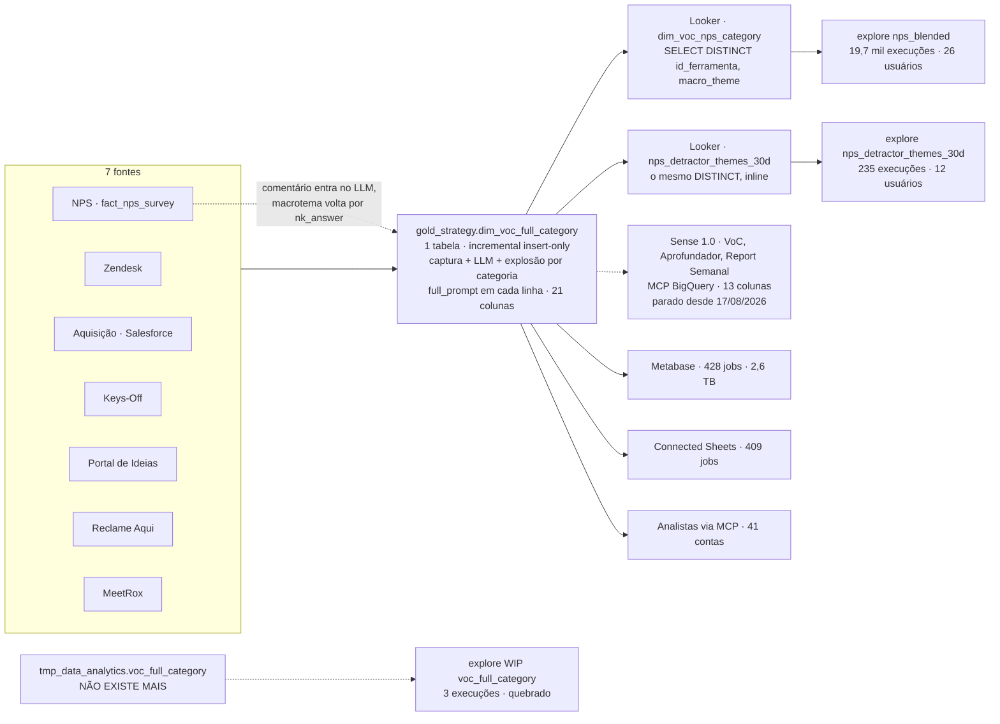
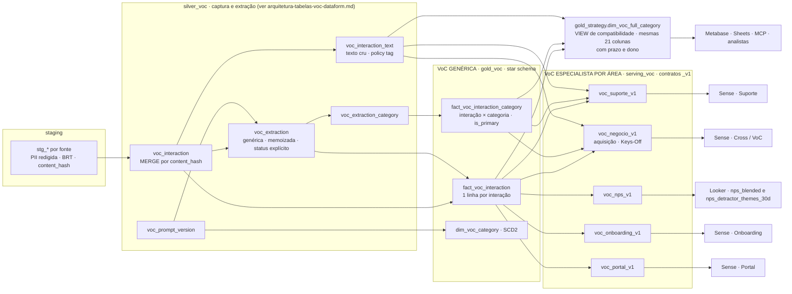

# Proposta — VoC genérica + VoC especialista por área (antes e depois)

> **Status:** rascunho para revisão · **Data:** 26/10/2026 (coluna Sense refeita com o código do `sense-platform`) · **Tipo:** `/propose` (para no plano: nenhum `.sqlx` escrito)
>
> **Pergunta que a proposta responde.** O que o time de NPS e o time de Sense realmente consomem da `gold_strategy.dim_voc_full_category`? A interseção justifica uma VoC **genérica** (um core único, população 100%) mais uma VoC **especialista por área** (contratos estreitos por consumidor)?
>
> **Relação com os outros documentos.** Complementa `arquitetura-tabelas-voc-dataform.md` (captura, idempotência, D-1 íntegro: camadas `silver_voc` / `gold_voc` / `serving_voc`) e `sense-reformulacao-contexto.md` (diagnóstico geral e FinOps). Este arquivo acrescenta o que faltava: **a evidência de consumo por coluna** e a **separação genérico × especialista** na camada gold/serving.

---

## 0. Resumo

1. **O NPS lê 3 das 21 colunas da tabela:** `source` (filtro `= 'nps'`), `id_ferramenta` (chave de join com `fact_nps_survey.nk_answer`) e `macro_theme`. Está comprovado no LookML e nos logs do BigQuery (a conta do Looker não referencia nenhuma outra coluna em 837 jobs).
2. **O código do Sense 1.0 lê 13 colunas, e as 3 do NPS estão dentro delas (NPS ⊂ Sense 1.0). Mas essa cadeia não roda desde 17/08/2026.** A interseção é de 3 colunas (4 contando `category_gemini`, que o NPS documenta e não usa nas views). Os Logs de Execução [PROD] do Notion e a assinatura das queries no BigQuery param no mesmo dia. Os especialistas do Sense 2.0 (Suporte, pNPS, Onboarding, Cross, Report Mensal) rodam até 26/10 sem referenciar a tabela, e o Portal só a usa como enriquecimento opcional. Cada um lê a sua fonte direto (Intercom e Zendesk, `gold_nps`, MeetRox, `silver_ideas_portal`; ver 1.7). **Hoje o único consumidor estruturado vivo é o NPS (Looker).**
3. **Os dois lados contornam o mesmo defeito de grão.** O NPS faz `SELECT DISTINCT id_ferramenta, macro_theme` em dois lugares do LookML; o Sense 1.0 usava `COUNT(DISTINCT id_ferramenta)`. A tabela mistura grãos (1 linha por interação × categoria; 1,14 linha/item no Zendesk, 1,80 no Reclame Aqui).
4. **O balde "Não é possível determinar" é o maior problema do lado NPS:** 43% dos itens de NPS (8.120 de 18.701 em 90 dias) e ~60% dos detratores, segundo a própria descrição do explore. A visão "Temas dominantes" é construída sobre os ~40% restantes.
5. **Existe um consumidor morto:** o explore `[WIP] Voice of Customer` aponta para `tmp_data_analytics.voc_full_category`, tabela que **não existe mais** no BigQuery.
6. **5 colunas não têm consumidor em código** (`category`, `ticket_type`, `meetrox_summary`, `full_prompt`, `llm_send_status`). `full_prompt` guarda ~30 mil caracteres por linha, e o Metabase faturou **2,6 TB em 90 dias** lendo a tabela.
7. **Proposta:** core genérico no grão da interação (`gold_voc`), mais **5 especialistas** em `serving_voc` (NPS, Suporte, Negócio, Onboarding, Portal), mais uma view de compatibilidade `dim_voc_full_category` para Looker, Metabase, Sheets e MCP durante a migração. Os especialistas do Sense (Suporte, Negócio, Onboarding, Portal) são consumo novo; o NPS é o primeiro e o único consumidor a migrar.

---

## 1. Evidência de consumo (hoje)

### 1.1 Como foi medido

| Fonte | O que deu | Janela |
|---|---|---|
| LookML do projeto `BI` (`1-NPS/...`), via MCP do Looker | Colunas lidas pelas views do NPS | estado atual |
| `INFORMATION_SCHEMA.JOBS_BY_PROJECT` (`contaazul-ssbi`, `region-us`) | Texto das queries → colunas referenciadas por canal | 90 dias até 26/10/2026 |
| `silver_information_schema.table_datalake_usage` / `table_usage_summary` | Jobs, contas, GB faturados por ferramenta | 90 dias |
| Looker System Activity (`history`) | Execuções e usuários por explore | 90 dias |
| Notion: Pattern do Agente VoC, NPS Source of Truth, Sense Central | Colunas **declaradas** por Sense e NPS | páginas de jun a set/2026 |
| `lake-index` (clone local de `gcp-dataform-contaazul`) | Consumidores internos no Dataform | snapshot local |
| Zip do `sense-platform` (`routines/prod`, `routines/dev`, `CLAUDE.md`), master de 21/10/2026 | Colunas lidas por cada agente, no código | snapshot de 21/10 |
| Notion · Logs de Execução — Sense [PROD] | Última execução real de cada agente | até 26/10/2026 |

**Limitações (leia antes de usar os números):**

- **Os logs não separam "time" de "ferramenta".** O Sense roda via MCP do BigQuery com credencial de pessoa (label `goog-mcp-server=true`). Por isso o consumo do Sense foi estabelecido pelo **código** das rotinas (colunas lidas) e confirmado por duas fontes independentes de execução: os Logs de Execução [PROD] do Notion e a **assinatura** de cada agente nos logs do BigQuery (ver 1.7). O perfil do canal MCP, com ~40 contas, continua sendo teto e não atribuição.
- **Dev e prod leem a mesma tabela** (`contaazul-ssbi.gold_strategy.dim_voc_full_category`, "compartilhado dev/prod" nos prompts), então a assinatura no BigQuery não distingue uma execução de dev de uma de prod. O Notion é a fonte da data de parada; o BigQuery confirma que nada rodou depois.
- **O `CLAUDE.md` do `sense-platform` está desatualizado.** Ele ainda descreve o Orquestrador Sense Diário (Comportamental → VoC → Priorizador → Aprofundador, 08h) como a cadeia ativa de prod, enquanto o Sense Central e os logs mostram a cadeia 1.0 parada.
- A conclusão "o Sense 2.0 não lê a tabela" vale para o snapshot de 21/10. Um agente criado depois dele não está coberto.
- A detecção de colunas é um regex sobre o texto da query. Nomes genéricos (`source`, `category`, `reason`) podem estar superestimados quando a query junta outras tabelas.
- O Looker usa cache: 837 jobs no BigQuery correspondem a bem mais execuções de explore.

### 1.2 Quem consome (90 dias)

| Canal | Jobs | Contas | GB faturados | Último acesso | Observação |
|---|---|---|---|---|---|
| MCP BigQuery | 3.720 | 41 | 664 | 23/10 | Analistas e a conta que operava a cadeia 1.0; só 149 jobs têm assinatura de agente Sense, todos até 17/08 (ver 1.7); 1 conta concentra a leitura de texto |
| Looker (`looker-sa`) | 837 | 1 | 26 | 22/10 | Só explores do NPS |
| Metabase (`metabase-sa`) | 428 | 1 | 2.640 | 23/10 | Maior custo por job (~6 GB/job) |
| Connected Sheets | 409 | 1 | 159 | 25/10 | Extração agendada (Zendesk: subcategoria, motivo, submotivo) |
| Dataform (leitura própria) | 184 | 1 | 941 | 24/10 | O `NOT EXISTS` do próprio incremental |
| Outros (ad-hoc) | 474 | até 22 | 656 | 25/10 | Leitura humana ad-hoc (`contaazul-ssbi` e `contaazul-datalake-prod` somados) |

**Dataform interno:** nenhum modelo faz `ref()` da `dim_voc_full_category` (lake-index, arestas = 0). **Todo consumo é externo** (Looker, Metabase, Sheets, MCP, agentes).

### 1.3 Looker (time de NPS): o que as views leem

| Explore (modelo `nps_data_mart`) | Execuções 90d | Usuários | Como lê a tabela |
|---|---|---|---|
| `nps_blended` | 19.668 | 26 | join com `dim_voc_nps_category` = `SELECT DISTINCT id_ferramenta, macro_theme WHERE source = 'nps'` |
| `nps_detractor_themes_30d` | 235 | 12 | o mesmo `DISTINCT` inline, cruzado com `fact_nps_survey` |
| `[WIP] voc_full_category` | 3 | 2 | **tabela `tmp_data_analytics.voc_full_category`: não existe** (execução mais recente: 26/10) |

Arquivos: `1-NPS/views/dim_voc_nps_category.view.lkml`, `1-NPS/views/nps_detractor_themes_30d.view.lkml`, `1-NPS/ssbi/views/voc_full_category.view.lkml`.

Só uma fração das execuções do Looker toca a tabela de VoC (837 jobs no BigQuery contra ~19,9 mil execuções do explore; o cache entra no meio). O macrotema é um complemento da análise de NPS, não o seu eixo.

### 1.4 Matriz coluna × consumidor (21 colunas)

`NPS (Looker)` vem do LookML; `NPS (SoT)`, da página "NPS - Source of Truth". `Sense 1.0` e `Sense 2.0` vêm do **código** das rotinas `prod` do `sense-platform` (zip de 21/10/2026): "sim" = a coluna aparece em SQL que o agente executa; "opc." = uso opcional (enriquecimento do Portal de Ideias). As colunas MCP, Metabase e Sheets são **jobs que citam a coluna** em 90 dias (totais: MCP 3.840, Metabase 428, Sheets 415; os totais diferem ~3% da tabela 1.2 porque são duas fontes de jobs).

| # | Coluna | NPS (Looker) | NPS (SoT) | Sense 1.0 | Sense 2.0 | MCP | Metabase | Sheets | Conjunto |
|---|---|:-:|:-:|:-:|:-:|--:|--:|--:|---|
| 1 | `source` | sim | sim | sim | opc. | 59% | 298 | 415 | **NPS ∩ Sense** |
| 2 | `id_ferramenta` | sim | sim | sim | opc. | 78% | 256 | 346 | **NPS ∩ Sense** |
| 3 | `macro_theme` | sim | sim | sim | não | 17% | 174 | 0 | **NPS ∩ Sense** |
| 4 | `category_gemini` | não | sim | sim | opc. | 28% | 271 | 0 | NPS declara, Sense usa |
| 5 | `nk_company_id` | não | não | sim | não | 47% | 271 | 415 | só Sense 1.0 |
| 6 | `nk_event_date` | não | não | sim | não | 95% | 408 | 415 | só Sense 1.0 |
| 7 | `ticket_subcategory` | não | não | sim | não | 6% | 276 | 346 | só Sense 1.0 |
| 8 | `reason` | não | não | sim | não | 58% | 227 | 278 | só Sense 1.0 |
| 9 | `sub_reason` | não | não | sim | não | 54% | 205 | 278 | só Sense 1.0 |
| 10 | `sentiment` | não | não | sim | opc. | 5% | 219 | 0 | só Sense (1.0 e Portal) |
| 11 | `incident_url` | não | não | sim | não | 27% | 231 | 0 | só Sense 1.0 |
| 12 | `problem_details` | não | não | sim | não | 64% | 92 | 0 | só Sense 1.0 |
| 13 | `incident_summary_gemini` | não | não | sim | não | 69% | 282 | 0 | só Sense 1.0 |
| 14 | `incident_type_gemini` | não | não | não | opc. | 1,6% | 172 | 0 | só Portal (2.0) |
| 15 | `nk_accountancy_id` | não | não | não | não | 0,8% | 2 | 0 | só Pulso de Suporte (dev) |
| 16 | `transcription` | não | não | não | não | 49% | 47 | 0 | só Pulso de Suporte (dev) |
| 17 | `category` | não | não | não* | não | 23% | 196 | 0 | sem consumidor em código |
| 18 | `ticket_type` | não | não | não | não | 4% | 163 | 0 | sem consumidor em código |
| 19 | `meetrox_summary` | não | não | não | não | 47% | 34 | 0 | sem consumidor em código |
| 20 | `full_prompt` | não | não | não | não | 0,9% | 3 | 0 | sem consumidor em código |
| 21 | `llm_send_status` | não | não | não | não | 1,7% | 21 | 0 | sem consumidor em código |

**Notas da matriz:**

- **Sense 1.0** = Oportunidades VoC, Aprofundador e Report Semanal. A cadeia está parada (ver 1.7).
- **Sense 2.0** = só o Portal de Ideias, como enriquecimento opcional. Suporte V2, pNPS, Onboarding, Cross e Report Mensal não referenciam a tabela (0 ocorrências em `routines/prod`).
- **Pulso de Suporte** (dev, sem cron prod) lê 12 colunas e é o único que usa `nk_accountancy_id` e `transcription`.
- \* `category` consta no Pattern do Agente VoC v3, mas nenhum SQL a lê (só comentários de mapeamento de nomes).
- **Sobre a coluna MCP.** O canal lê muito texto (`problem_details` 64%, `incident_summary_gemini` 69%, `transcription` 49%, `meetrox_summary` 47%), e a maior parte vem de uma única conta em consulta exploratória (ver 1.7). Não é leitura de agente documentado.

### 1.5 A interseção, em operações de conjunto

| Conjunto | Colunas | Tamanho |
|---|---|---|
| A = NPS, consumo real (Looker + logs) | `source`, `id_ferramenta`, `macro_theme` | 3 |
| A' = NPS, consumo declarado (SoT) | A + `category_gemini` | 4 |
| B = Sense 1.0, código (Oportunidades VoC + Aprofundador + Report Semanal) | `source`, `id_ferramenta`, `macro_theme`, `category_gemini`, `nk_company_id`, `nk_event_date`, `ticket_subcategory`, `reason`, `sub_reason`, `sentiment`, `incident_url`, `problem_details`, `incident_summary_gemini` | 13 |
| C = Sense 2.0, código (Portal, opcional) | `source`, `id_ferramenta`, `sentiment`, `incident_type_gemini`, `category_gemini` | 5 |
| D = Pulso de Suporte, código (dev) | `source`, `nk_company_id`, `nk_accountancy_id`, `nk_event_date`, `ticket_subcategory`, `reason`, `problem_details`, `transcription`, `sentiment`, `macro_theme`, `incident_summary_gemini`, `category_gemini` | 12 |
| **A ∩ B** | `source`, `id_ferramenta`, `macro_theme` | **3** |
| **A' ∩ B** | A ∩ B + `category_gemini` | **4** |
| A ∩ C | `source`, `id_ferramenta` | 2 |
| B − A' (só Sense 1.0) | `nk_company_id`, `nk_event_date`, `ticket_subcategory`, `reason`, `sub_reason`, `sentiment`, `incident_url`, `problem_details`, `incident_summary_gemini` | 9 |
| A − B (só NPS) | nenhuma | 0 |
| Só no Pulso (dev) | `nk_accountancy_id`, `transcription` | 2 |
| Só no Portal (2.0) | `incident_type_gemini` | 1 |
| Nenhum consumidor em código (fora de A', B, C, D) | `category`, `ticket_type`, `meetrox_summary`, `full_prompt`, `llm_send_status` | 5 |

**Leitura.** NPS e Sense compartilham só o "esqueleto" (qual fonte, qual item, qual macrotema) e divergem na granularidade. O NPS trabalha no nível do **macrotema** (poucos valores, uma linha por resposta). O Sense 1.0 trabalhava no nível da **categoria fina** (272 subcategorias), com **empresa, data, texto e churn** para contar clientes impactados. Um contrato único não serve bem aos dois: o NPS paga o peso das colunas do Sense, e o Sense herda o grão e o default silencioso pensados sem ele.

**O que muda com o código do Sense na mão.** O consumidor que usa o grosso das colunas (Sense 1.0, 13 colunas) está parado desde 17/08/2026 (ver 1.7), e nenhum agente do 2.0 depende da tabela. Na prática, o contrato vivo de hoje é o do NPS (3 colunas) mais o de quem consulta no exploratório. O contrato do Sense 2.0 é uma decisão de desenho para frente, não uma migração.

### 1.6 Achados que mudam o desenho

| # | Achado | Evidência | Consequência |
|---|---|---|---|
| F1 | **Grão misto** obriga os dois consumidores a deduplicar | Linhas por item em 90 dias: Zendesk 1,14 · Reclame Aqui 1,80 · portal de ideias 1,21 · NPS 1,02 (284 linhas repetidas). NPS usa `DISTINCT` em 2 views; Sense 1.0 usava `COUNT(DISTINCT)` | Core no grão da interação, categoria em tabela de relação |
| F2 | **Default silencioso** domina o NPS | `macro_theme = 'Não é possível determinar'`: NPS 43% (8.120/18.701), aquisição 29% (4.633/15.712), Zendesk 0,4%, Keys-Off 1,5%. No NPS, `nao_enviado_sem_info` = 0 e o payload médio é ~48 caracteres (medição de 30 dias do doc de contexto): indica que respostas sem comentário, só com a classificação, **vão ao LLM** e voltam indeterminadas (hipótese a confirmar medindo o tamanho de `reason`, o comentário, nos itens indeterminados) | Status de extração explícito (`ok`, `sem_texto`, `indeterminado`, `erro_api`); o NPS pára de excluir uma string |
| F3 | **Regra duplicada no LookML** | O mesmo `SELECT DISTINCT ... WHERE source = 'nps'` está em `dim_voc_nps_category` e em `nps_detractor_themes_30d` | Uma única tabela especialista `voc_nps` como fonte das duas views |
| F4 | **Explore órfão** | `[WIP] voc_full_category` → `tmp_data_analytics.voc_full_category`: `get_table_info` = Not found; ausente da listagem do dataset (41 tabelas). Última leitura: MCP 14/08, Metabase 19/08. O `schema-ca` já a marcava como "Legada" (snapshot de 07/05, 24 colunas, 4 fontes, sem `nk_company_id`) | Remover o explore e a view, ou repontá-los para o especialista |
| F5 | **Aresta circular de dados** | `gold_nps.fact_nps_survey` alimenta a `dim_voc_full_category` (CTE `nps`, DATA-20997), e o Looker junta o macrotema de volta em `fact_nps_survey` por `nk_answer` | O especialista NPS expõe também `sk_nps_survey`; o join do Looker migra para essa chave |
| F6 | **Coluna cara e sem consumidor** | `full_prompt` ≈ 30 mil caracteres por linha; Metabase = 2.640 GB faturados em 90 dias (428 jobs, ~6 GB/job); a coluna é lida por 3 jobs no Metabase | Prompt vai para tabela de versão (`nk_prompt_version_id`); texto cru sai do caminho largo |
| F7 | **Consumo concentrado e heterogêneo** | MCP 3.720 jobs/41 contas · Looker 837 · Metabase 428 · Sheets 409 (1 agendamento) · outros 474 | A view de compatibilidade precisa ter prazo e dono; não dá para só trocar a tabela |

| F8 | **O Sense não consome a tabela hoje** | Cadeia 1.0 sem execução desde 17/08/2026 (Notion e BigQuery); especialistas 2.0 não referenciam a tabela; `CLAUDE.md` do repositório desatualizado (ver 1.7) | Os especialistas do Sense (Suporte, Negócio, Onboarding, Portal) são consumo novo, não migração; o NPS é o primeiro e o único consumidor a migrar |

### 1.7 O Sense hoje: o que roda e o que não roda

O `sense-platform` (snapshot de 21/10/2026) tem 4 rotinas de prod que citam a tabela e 1 de dev. A tabela cruza o código com as execuções reais, em duas fontes independentes: os Logs de Execução [PROD] do Notion e a assinatura exata das queries no BigQuery.

| Rotina | Cadeia | Colunas lidas (código) | Última execução prod (Notion) | Última assinatura no BigQuery |
|---|---|---|---|---|
| Orquestrador Sense Diário | 1.0 | n/a (despacha os filhos às 08h) | 17/08/2026 (28 runs live) | n/a |
| Oportunidades VoC (`bq_build_queries.py`) | 1.0 | `source`, `id_ferramenta`, `nk_company_id`, `nk_event_date`, `category_gemini`, `ticket_subcategory`, `reason` | 17/08/2026 (24 runs live) | 17/08/2026 |
| Aprofundador | 1.0 | as 7 acima + `sentiment`, `sub_reason`, `macro_theme`, `incident_url`, `problem_details`, `incident_summary_gemini` | 17/08/2026 (14 runs live) | 17/08/2026 |
| Report Semanal | 1.0, standalone | `source`, `nk_event_date`, `category_gemini`, `ticket_subcategory` | 10/08/2026 (7 runs live) | 17/08/2026 |
| Portal de Ideias | 2.0 | `source`, `id_ferramenta`, `sentiment`, `incident_type_gemini`, `category_gemini`, só como enriquecimento opcional | 01/10/2026 (3 runs live) | 01/09/2026; nenhuma com `source = 'ideas_portal'` em 01/10 |
| Suporte V2, pNPS, Onboarding, Cross, Report Mensal | 2.0 | nenhuma (0 referências em `routines/prod`) | 26/10, 16/10, 25/10, 04/10, 04/10 | n/a |
| Pulso de Suporte | dev | 12 colunas, entre elas `nk_accountancy_id` e `transcription` | n/a (só dev) | 29 jobs MCP citam `nk_accountancy_id` em 90 dias: não roda toda noite |

**Assinaturas das queries dos agentes 1.0 no BigQuery (170 dias, todas sob uma única conta):**

| Assinatura | Jobs | Dias distintos | Primeiro | Último |
|---|---|---|---|---|
| UNION ALL de métricas por OP (`metric_flip`) | 15 | 11 | 18/06 | 17/08 |
| Detecção de novas oportunidades H1 a H5 (`chamados_anterior`) | 36 | 11 | 26/06 | 17/08 |
| Aprofundador, decomposição com churn (`churn_mas_ativa`) | 42 | 9 | 01/07 | 17/08 |
| Aprofundador, panorama por fonte (`tom_neg`) | 20 | 9 | 01/07 | 17/08 |
| Report Semanal (anti-cache `RAND() >= 0`) | 36 | 10 | 25/06 | 17/08 |

**O que isso prova:**

1. **A cadeia 1.0 parou em 17/08/2026.** É a última run live do Orquestrador, do VoC e do Aprofundador no Notion, e a última assinatura no BigQuery. Foi cinco dias antes do go-live do Sense 2.0 (22/08). O Report Semanal tem a última run prod em 10/08 no Notion e a última assinatura em 17/08 no BigQuery, o que sugere execução de dev ou de teste no meio.
2. **Depois de 17/08, a conta que operava a cadeia fez 2.252 jobs na tabela** (1.291 só em outubro), nenhum com assinatura de agente. É consulta exploratória de texto, não leitura de rotina.
3. **Nenhum agente do Sense 2.0 depende da tabela.** O Portal a cita como enriquecimento opcional e, em 01/10, rodou sem ler `source = 'ideas_portal'`. O Suporte V2 (execução diária, a mais recente em 26/10) lê Intercom e Zendesk direto.
4. **A documentação do repositório está desatualizada:** o `CLAUDE.md` do `sense-platform` descreve a cadeia 1.0 como ativa em prod.
5. **Consequência para o desenho:** hoje o NPS é o único consumidor estruturado vivo. Os especialistas do Sense nascem como consumo novo, e o conjunto de colunas deles parte do que a cadeia 1.0 lia, mais os prompts atuais do 2.0.

**De onde o Sense 2.0 lê a voz do cliente, então (código de `routines/prod`):**

| Especialista 2.0 | Fonte de voz do cliente | Tabelas e sistemas que o agente consulta | Quem interpreta | Cobertura na `dim_voc_full_category` |
|---|---|---|---|---|
| Suporte V2 | Conversas do Intercom e tickets do Zendesk | `silver_serve.ingestion_intercom_conversations`, `silver_serve.ingestion_intercom_messages`, `gold_serve.dim_zendesk_tickets_detailed`; usa sobretudo o `ai_issue_summary` do Intercom | O próprio agente, com amostragem e agrupamento em contexto | Zendesk sim; **o Intercom não está na tabela** |
| pNPS | Respostas de NPS (Survicate) | `gold_nps.fact_nps_survey`, `gold_capro_features.fact_capro_features`, `gold_partners.*`, `gold_common.dim_company`, `silver_ds_churn.churn_score_prediction`; "amplitude" nos prompts é a amplitude de features (`fact_capro_features`), não a ferramenta Amplitude | O próprio agente | NPS sim (macrotema), mas o agente não usa |
| Onboarding | Reuniões de setup (MeetRox) e Salesforce | `gold_onboarding.dim_onboarding_meetings`, `fact_onboarding_activation`, `fact_onboarding_funnel`, `gold_common.dim_company`; MeetRox pela API | O próprio agente | Não: o MeetRox só aparece na tabela como resumo de ligação de ticket do Zendesk |
| Portal de Ideias | Ideias do portal | `silver_ideas_portal.ideas_portal`; gold própria `tmp_data_analytics.sense_ideas_portal_*` (clusters e votos); `gold_common.dim_company` | O próprio agente, com clusters próprios | Parcial: de 2025 em diante, sem votos nem cluster; só enriquecimento opcional |
| Cross | Sinais dos 4 especialistas, no Notion | Notion; `silver_master_data.company` | O próprio agente | Não se aplica |

**Leitura.** O Sense 2.0 tem quatro leituras de voz do cliente em paralelo à VoC populacional, cada uma com a sua interpretação feita dentro do agente. É a duplicação do "map" que esta proposta quer trocar por uma classificação comum no core, com o especialista de cada área como contrato de leitura. O Intercom é a lacuna mais concreta: a fonte do Suporte V2 nem entra na VoC hoje (o documento de arquitetura já a inclui como fonte nova da captura).

---

## 2. Antes (As-Is)



**Propriedades do As-Is:**

| Aspecto | Hoje |
|---|---|
| Contrato | Um só, de 21 colunas, para todos os consumidores |
| Grão | Interação × categoria (mistura: categoria explode, macrotema e tipo pegam o 1º valor) |
| Quem deduplica | Cada consumidor, do seu jeito |
| Status de extração | Não existe; erro de API, JSON inválido e "indeterminado" saem como a mesma string |
| Linhagem do prompt | `full_prompt` em cada linha (~30 mil caracteres) |
| Dono | Sem contrato por consumidor; alterar uma coluna pode quebrar Looker, Metabase, Sheets e agentes sem aviso |
| Custo de leitura | Todo consumidor varre a mesma tabela larga |

---

## 3. Depois (To-Be): VoC genérica + VoC especialista por área

### 3.1 Princípio e regra de decisão

- **VoC genérica (core):** o que **toda** área precisa e que se calcula **uma vez por interação**, para 100% da população: identidade da interação, fonte, empresa, data, macrotema, categoria principal, sentimento, tipo, resumo e status da extração. Estável, pouco versionado.
- **VoC especialista (por área):** uma tabela de contrato estreita por consumidor, em `serving_voc`, versionada no nome (`_v1`). É uma **lente** sobre o core: seleciona o recorte da área, junta os atributos que só ela usa e esconde o resto. Quando a área precisa de um campo que o core não calcula, o especialista pode ter uma **extração própria** (um prompt adaptador só sobre o subconjunto da área).

| Pergunta | Onde mora a coluna |
|---|---|
| Usada por 2 ou mais áreas (matriz 1.4)? | **Core** |
| Usada por uma área só? | **Especialista** dessa área |
| Texto cru, com PII (`reason`, `transcription`, `meetrox_summary`, `problem_details`)? | **Tabela restrita** (`silver_voc`), exposta só nos especialistas que usam, com policy tag |
| Linhagem (`full_prompt`)? | **Tabela de versão** (`nk_prompt_version_id`), nunca nos consumidores |
| Sem consumidor em código (matriz 1.4)? | Fica no core só se for barata e estável; senão sai |

### 3.2 Diagrama



Nomes seguem o repositório: o gold usa `fact_` (91 modelos) e `dim_` (107), com zero `fct_` e zero `bridge_`. Por isso a relação interação × categoria entra como `fact_voc_interaction_category` (factless fact). A camada `serving` hoje tem um único modelo (`serving_partners.start_onboarding_v1`); os especialistas seguem esse precedente.

**Ajustes em relação a `arquitetura-tabelas-voc-dataform.md`:**

1. `fct_voc_*` vira `fact_voc_*` (convenção do repositório).
2. O texto cru sai de `silver_voc.voc_interaction` e vai para uma tabela restrita, `voc_interaction_text` (policy tag), porque só Suporte e Negócio leem texto.
3. A staging do prompt segue o padrão existente `dataform_staging.google_sheets_<entidade>` (sem prefixo `stg_`): `google_sheets_voc_prompt`. Hoje não existe staging para essa planilha, então ela é task **antes** da silver.

### 3.3 Para onde vai cada coluna

| Coluna atual | Destino | Observação |
|---|---|---|
| `id_ferramenta` | core `fact_voc_interaction.id_ferramenta` (legado) + `nk_voc_id` (nova chave) | Para NPS, o legado é `nk_answer`, que **não é global**; o especialista expõe `sk_nps_survey` |
| `source`, `nk_company_id`, `nk_accountancy_id`, `nk_event_date` | core | `nk_event_date` vira `event_date` (BRT) |
| `macro_theme`, `category_gemini` (principal), `sentiment`, `incident_type_gemini`, `incident_summary_gemini` | core | Valor único por interação; categorias secundárias em `fact_voc_interaction_category` |
| `llm_send_status` | core `extraction_status` | Domínio: `ok`, `sem_texto`, `indeterminado`, `erro_api`, `invalid_label` |
| `reason`, `sub_reason`, `problem_details`, `transcription`, `meetrox_summary` | `silver_voc.voc_interaction_text` (restrita) → especialistas que usam | Só Suporte e Negócio. `meetrox_summary` não tem consumidor em código: entra só se Onboarding ou Suporte pedirem |
| `category`, `ticket_subcategory`, `ticket_type`, `incident_url` | especialista Suporte (atributos de origem do ticket) | `category` e `ticket_type` não têm consumidor em código: ficam só se o dono do Suporte pedir. `category` do NPS (Detrator/Neutro/Promotor) fica no `fact_nps_survey` |
| `full_prompt` | `silver_voc.voc_prompt_version` | Troca ~30 mil caracteres por linha por um `nk_prompt_version_id` |

### 3.4 Os especialistas

| Especialista | Grão | O que lê do core | O que a área acrescenta | Consumidor |
|---|---|---|---|---|
| `serving_voc.voc_nps_v1` | 1 resposta de NPS | `nk_voc_id`, `id_ferramenta`, `event_date`, `macro_theme`, `category_gemini` principal, `sentiment`, `extraction_status` | `sk_nps_survey`, `macro_theme_status` (`classificado`, `sem_comentario`, `indeterminado`, `erro_api`) | Looker `nps_blended`, `nps_detractor_themes_30d`, ritos Weekly NPS |
| `serving_voc.voc_suporte_v1` | 1 interação de suporte (Zendesk, Intercom, Reclame Aqui) | core + categorias + texto | atributos do ticket (`ticket_type`, `ticket_subcategory`, `incident_url`); fase seguinte: `cluster_id` e `problema_canonico` | Extração agendada em Sheets, Metabase e o Sense Suporte (04h), que hoje lê Intercom e Zendesk direto e não esta tabela |
| `serving_voc.voc_negocio_v1` | 1 lead perdido ou cancelamento (aquisição, Keys-Off) | core + `reason`/`sub_reason` | data da perda, join de churn (`silver_master_data.company`) | Hipóteses H3/H4 do Agente VoC 1.0 (parado); insumo candidato do Cross |
| `serving_voc.voc_onboarding_v1` | 1 reunião (MeetRox) | core | tipo e data da reunião (hoje só pela API) | Sense Onboarding (hoje lê o MeetRox pela API) |
| `serving_voc.voc_portal_v1` | 1 ideia | core | cluster da ideia, snapshot mensal de votos | Sense Portal (hoje usa a tabela só como enriquecimento opcional) |

**Os especialistas do Sense são consumo novo, não migração.** Nenhum agente do 2.0 lê a tabela hoje (ver 1.7). O desenho do Suporte, do Negócio, do Onboarding e do Portal parte do que a cadeia 1.0 lia e dos prompts atuais, e o Sense só passa a ler quando o dono do agente decidir adotar o contrato.

**Duas formas de especialista, sem custo extra de LLM no começo:**

1. **Lente** (projeção do core, custo LLM zero): `voc_nps_v1` e `voc_negocio_v1` começam assim.
2. **Enriquecimento** (extração própria sobre o subconjunto da área): `voc_suporte_v1` (cluster/problema canônico) e o NPS, se precisar de subtemas finos além do macrotema. É onde o NPS hoje tem lacuna: o explore descreve a granularidade como "limitada às 4 categorias amplas do macrotema".

### 3.5 Contrato por alvo (formato do `spec.md`)

Os modelos `silver_voc.*` e a captura idempotente estão fechados em `arquitetura-tabelas-voc-dataform.md` §4 a §6. Abaixo, os alvos **novos** desta proposta.

#### `definitions/gold/voc/tables/fact_voc_interaction.sqlx` (Create)

| Item | Valor |
|---|---|
| Propósito | Uma interação de cliente (item de uma fonte), versão vigente, com a extração genérica `ok` |
| Grão | uma linha representa **1 interação** (`source` + chave natural da origem) |
| Chave primária | `nk_voc_id` |
| Frequência (tag) | `daily` |
| Camada · Schema | gold · `gold_voc` |
| Tipo | `table` (reconstruída a cada run: join barato de `voc_interaction` com `voc_extraction`) |
| Volume estimado | ~114,6 mil itens em 90 dias (≈1,3 mil/dia); histórico ~0,9 milhão de linhas atuais (Notion, set/2026), menos as linhas explodidas por categoria |
| Partição/cluster | `event_date` (dia) · `source`, `nk_company_id` |
| Colunas | `nk_voc_id`, `source`, `id_ferramenta`, `nk_company_id`, `nk_accountancy_id`, `event_date`, `macro_theme`, `nk_primary_category_id`, `sentiment`, `interaction_type`, `incident_summary`, `extraction_status`, `nk_extraction_id`, `nk_prompt_version_id` |

#### `definitions/gold/voc/tables/fact_voc_interaction_category.sqlx` (Create)

| Item | Valor |
|---|---|
| Grão | 1 linha por (interação, categoria) |
| Chave primária | `nk_voc_id`, `nk_category_id` |
| Tipo | `table` · partição `event_date` · cluster `nk_category_id` |
| Colunas | `nk_voc_id`, `nk_category_id`, `is_primary`, `event_date` |

#### `definitions/gold/voc/tables/dim_voc_category.sqlx` (Create)

| Item | Valor |
|---|---|
| Grão | 1 linha por categoria × vigência (SCD2) |
| Chave primária | `nk_category_id`, `valid_from` |
| Tipo | `table` (272 subcategorias hoje) |
| Fonte | planilha `voc_prompt` via `google_sheets_voc_prompt` (`is_valid` na `voc_prompt_version`) |

#### `definitions/serving/voc/tables/voc_nps_v1.sqlx` (Create, o primeiro especialista)

| Item | Valor |
|---|---|
| Propósito | Classificação por LLM de cada resposta de NPS, no contrato que o Looker consome |
| Grão | 1 resposta de NPS |
| Chave primária | `sk_nps_survey` (único); `id_ferramenta` (= `nk_answer`) mantida como chave legada de join |
| Tipo | `table` com substituição atômica e guardas da serving |
| Volume estimado | ~18,7 mil respostas em 90 dias |
| Colunas | `sk_nps_survey`, `id_ferramenta`, `event_date`, `macro_theme`, `macro_theme_status`, `category_gemini`, `sentiment`, `extraction_status`, `published_at`, `nk_publication_id` |
| Fonte | `fact_voc_interaction` com `source = 'nps'` |
| Consumidores | `looker/1-NPS/views/dim_voc_nps_category.view.lkml`, `looker/1-NPS/views/nps_detractor_themes_30d.view.lkml` |

**Assertions (mínimo da camada):** `uniqueKey` + `nonNull` na chave primária de cada alvo acima. Nenhuma `rowConditions` entra por conta própria nesta proposta: só as exigidas pelo README da `serving` (origem: restrição da camada), a confirmar no build.

#### `serving_voc.voc_suporte_v1`, `voc_negocio_v1`, `voc_onboarding_v1`, `voc_portal_v1` (Create, fase seguinte)

Esboço na tabela 3.4. O contrato completo de cada um fecha na hora de construir, com o dono da área e os prompts do Sense 2.0 (`routines/prod` do `sense-platform`, ver 1.7). Como o Sense 2.0 ainda não lê a tabela, o conjunto de colunas desses especialistas parte do que a cadeia 1.0 lia (matriz 1.4) e dos prompts atuais do Suporte, do Onboarding e do Portal.

### 3.6 Comparação com o modelo atual

| Aspecto | Antes (`dim_voc_full_category`) | Depois |
|---|---|---|
| Grão | Interação × categoria, com macrotema e tipo no 1º valor | Core: 1 interação. Categoria: tabela própria. Especialistas: 1 item da área |
| Contrato | 21 colunas para todos | Core de ~14 colunas + especialistas de 6 a 10 colunas |
| Dedup | Cada consumidor (`DISTINCT`, `COUNT DISTINCT`) | Garantido pela chave primária; sem `DISTINCT` no consumidor |
| Status de extração | Inexistente (default `'Não é possível determinar'`) | `extraction_status` e `macro_theme_status` explícitos |
| Linhagem do prompt | `full_prompt` em cada linha | `nk_prompt_version_id` |
| Texto cru | Em toda leitura | Tabela restrita; só nos especialistas que usam |
| Materialização | Incremental insert-only | Gold `table`; serving com publicação e guardas |
| Compatibilidade | n/a | View `gold_strategy.dim_voc_full_category` com as 21 colunas, no grão antigo |

---

## 4. Migração por consumidor

| Consumidor | Hoje | Depois | Passo | Critério de saída |
|---|---|---|---|---|
| Looker NPS (`dim_voc_nps_category`, `nps_detractor_themes_30d`) | `DISTINCT` direto na `dim_voc_full_category` | Lê `serving_voc.voc_nps_v1`; join por `sk_nps_survey`; `macro_theme_status` substitui o filtro `!= 'Não é possível determinar'` | Repontar as duas views; validar em shadow | Mesmos totais por tema nas duas views (diferença explicada apenas pela cobertura) |
| Explore `[WIP] voc_full_category` | Tabela `tmp_` inexistente | Removido (ou repontado para o especialista de Suporte, se o time quiser o explore) | Apagar `ssbi/explores` e `ssbi/views` | Sem execuções quebradas |
| Sense 1.0 (Orquestrador, VoC, Aprofundador, Report Semanal) | MCP direto na tabela monolítica; parado desde 17/08/2026 | Sem migração enquanto estiver parado; se for reativado, lê o especialista da área | Decisão 3 | n/a |
| Sense 2.0 (Suporte, pNPS, Onboarding, Cross, Report Mensal) | Não lê a tabela (o Portal a usa como enriquecimento opcional) | Passa a ler o especialista da área, como consumo novo | Quando o contrato da área fechar (Fases 3 e 4) | Duas semanas de paridade com a leitura atual de cada agente (Intercom, `gold_nps`, MeetRox) |
| Metabase | 428 jobs, 2,6 TB, todas as colunas | View de compatibilidade primeiro; depois cards migram para core/especialista | Mapear cards (pendência) | Zero leitura da view de compatibilidade |
| Connected Sheets (1 agendamento) | Subcategoria, motivo, submotivo do Zendesk | `voc_suporte_v1` | Avisar o dono | Agendamento repontado |
| Analistas via MCP | Texto cru e resumo por IA | Core e especialistas; texto cru só pela tabela restrita | Comunicar o novo mapa de tabelas | — |

A view de compatibilidade `gold_strategy.dim_voc_full_category` mantém as 21 colunas e o grão antigo (interação × categoria), montada a partir do core, da relação de categorias e do texto. Deve nascer com **prazo de desligamento e dono**: sem isso ela vira o novo monólito.

---

## 5. Decisões em aberto

| # | Decisão | Opções | Recomendação |
|---|---|---|---|
| 1 | O que é "área"? | (a) consumidor/fonte: NPS, Suporte, Negócio, Onboarding, Portal; (b) domínio DDD: Payroll, Banking, Fiscal... | (a) nos contratos de `serving`; o domínio DDD entra como coluna do core (`ddd_domain`, `ddd_subdomain`), porque o Sense já classifica oportunidades por domínio e subdomínio |
| 2 | O tráfego MCP da conta que operava a cadeia 1.0, depois de 17/08 (2.252 jobs, leitura de texto), é trabalho do Sense? | Confirmar a conta e o propósito; classificar as outras ~39 contas | **Precisa de você:** os logs não separam time de ferramenta (ver 1.1). Decide se existe um consumidor exploratório do Sense que o contrato do Suporte e do Negócio precisa atender |
| 3 | Cadeia 1.0 do Sense (Orquestrador, VoC, Aprofundador, Report Semanal) | Reativar, aposentar ou reescrever sobre os especialistas | Decidir com o dono do Sense. Enquanto isso, atualizar o `CLAUDE.md` do `sense-platform` e o Sense Central: um diz que a cadeia roda às 08h, o outro (e os logs) que está parada |
| 4 | Reclame Aqui entra em Suporte ou em Negócio? | Suporte (ouvidoria via Zendesk) ou Negócio | Suporte, com `source = 'reclame_aqui'` filtrável |
| 5 | Subtemas finos para o NPS | Só macrotema (lente) ou extração própria no NPS | Começar como lente; abrir enriquecimento depois da Fase 2, se o rito Weekly pedir |
| 6 | Dono do contrato de cada especialista | Dados ou a área consumidora | Dados mantém o core; a área aprova o contrato do seu especialista |
| 7 | Prazo da view de compatibilidade | 60, 90 ou 120 dias | 90 dias, com alerta de leitura por conta |

---

## 6. Riscos

| Risco | Impacto | Mitigação |
|---|---|---|
| Assinatura no BigQuery não distingue dev de prod | O último job do Report Semanal (17/08) é posterior à última run prod no Notion (10/08), então parte das execuções pode ser de dev ou de teste | Usar o Notion como fonte da data de parada e o BigQuery como confirmação |
| "O Sense 2.0 não lê a tabela" vale para o snapshot de 21/10 | Um agente criado depois pode ler a tabela | Repetir a busca por `dim_voc_full_category` no `sense-platform` antes de fechar o contrato dos especialistas do Sense |
| Regex superestima colunas genéricas | `source`, `category` e `reason` podem parecer mais usadas | Tratar como teto; o NPS (Looker) está exato porque vem do LookML |
| `silver_voc` ler `silver_nps.nps_survey` em vez da gold | `fact_nps_survey` hoje fornece classificação, campanha e conta de contador usadas pela VoC | Confirmar as colunas na silver antes de construir (já listado no documento de arquitetura) |
| Troca de chave do NPS (`nk_answer` → `sk_nps_survey`) | Quebra o join do Looker | Especialista expõe as duas chaves durante a migração |
| Serving com um único modelo de precedente | Guardas pouco exercitadas | Seguir `definitions/serving/README.md` e `serving_assertions.js` |
| Quebra de série na troca de taxonomia e na separação de status | Tendências históricas mudam de nível | Semente `legacy` na extração, sem reclassificar o histórico; documentar o degrau |
| Cards do Metabase desconhecidos (428 jobs) | Quebra silenciosa ao desligar a view de compatibilidade | Mapear cards antes de definir a data |

---

## 7. Plano e tasks

Reaproveita as etapas 0 a 7 de `arquitetura-tabelas-voc-dataform.md` §9 e acrescenta a camada especialista.

| Fase | Escopo | Critério de saída |
|---|---|---|
| 0. Higiene imediata | Remover o explore órfão; `protected: true`; corte por `CURRENT_DATE('America/Sao_Paulo')`; corrigir a documentação da cadeia 1.0 do Sense | Explore removido; sem mudança de volume; `CLAUDE.md` e Sense Central coerentes |
| 1. Core | `silver_voc.*`, `fact_voc_interaction`, `fact_voc_interaction_category`, `dim_voc_category` em shadow ao lado da tabela atual | Conciliação item a item (90 dias) com a `dim_voc_full_category` |
| 2. Primeiro especialista: NPS | `serving_voc.voc_nps_v1`; repontar as duas views do Looker | Totais por tema iguais; `DISTINCT` removido do LookML |
| 3. Suporte e Negócio | `voc_suporte_v1`, `voc_negocio_v1`; o Sense passa a ler o especialista (consumo novo) | Duas semanas de paridade com a leitura atual do agente (Intercom e Zendesk) |
| 4. Onboarding e Portal | `voc_onboarding_v1`, `voc_portal_v1` | Agentes fora da API e do `tmp_data_analytics` |
| 5. Compatibilidade e desligamento | View `dim_voc_full_category`; migrar Metabase e Sheets; fixar a data de desligamento | Zero leitura da view por 30 dias |

**Tasks (repositório `gcp-dataform-contaazul`, não esta pasta):**

- [ ] `definitions/staging/google_sheets/google_sheets_voc_prompt.sqlx` — Create: staging do prompt (pré-requisito de `voc_prompt_version`; a bronze `bronze_tool_ext_google_sheets.voc_prompt` ainda não tem staging)
- [ ] `definitions/silver/voc/tables/voc_interaction.sqlx`, `voc_interaction_text.sqlx`, `voc_extraction.sqlx`, `voc_extraction_category.sqlx`, `voc_prompt_version.sqlx` — conforme o documento de arquitetura
- [ ] `definitions/gold/voc/tables/fact_voc_interaction.sqlx` — Create
- [ ] `definitions/gold/voc/tables/fact_voc_interaction_category.sqlx` — Create
- [ ] `definitions/gold/voc/tables/dim_voc_category.sqlx` — Create
- [ ] `definitions/serving/voc/tables/voc_nps_v1.sqlx` — Create
- [ ] `definitions/gold/strategy/tables/dim_voc_full_category.sqlx` — virar view de compatibilidade (última fase)
- [ ] Looker (`looker/1-NPS`): repontar `dim_voc_nps_category.view.lkml` e `nps_detractor_themes_30d.view.lkml`; remover `ssbi/explores/voc_full_category.explore.lkml` e `ssbi/views/voc_full_category.view.lkml`
- [ ] Confirmar a conta MCP do Sense e mapear os cards do Metabase (decisão 2 e risco do Metabase)
- [ ] `sense-platform`: atualizar o `CLAUDE.md` e o Sense Central conforme a decisão 3 (a cadeia 1.0 está parada desde 17/08)
- [ ] `/run-dataform` — validar no dev (opt-in)
- [ ] `/ship` — publicar

**Próximo passo sugerido:** quando a decisão 1 (o que é "área") estiver fechada, `/build-dataform` a partir deste arquivo, começando pelo core e pelo especialista de NPS. As decisões 2 e 3 não bloqueiam essa primeira entrega. Se preferir o fluxo padrão, posso quebrar a seção 3.5 em `artifacts/<slug>/spec.md` dentro do repositório Dataform.

---

## Apêndice A — Consultas usadas (BigQuery, `contaazul-ssbi`, somente leitura)

**A.1 — Uso por canal (90 dias)**

```sql
SELECT service_name, referenced_project_id,
       COUNT(DISTINCT job_id) AS jobs, COUNT(DISTINCT user_email) AS users,
       COUNT(DISTINCT DATE(creation_time)) AS distinct_days,
       ROUND(SUM(total_bytes_billed)/POW(1024,3),0) AS gb_billed,
       MAX(creation_time) AS last_read_at
FROM `contaazul-datalake-prod.silver_information_schema.table_datalake_usage`
WHERE dataset_id = 'gold_strategy' AND table_id = 'dim_voc_full_category'
  AND creation_time >= DATETIME_SUB(CURRENT_DATETIME(), INTERVAL 90 DAY)
GROUP BY 1,2 ORDER BY jobs DESC;
```

**A.2 — Colunas citadas por canal (regex sobre o texto da query; resumido a 2 colunas)**

```sql
WITH j AS (
  SELECT user_email, LOWER(query) AS q,
    CASE
      WHEN user_email LIKE 'looker-sa@%' THEN 'looker'
      WHEN user_email LIKE 'metabase-sa@%' THEN 'metabase'
      WHEN EXISTS (SELECT 1 FROM UNNEST(labels) l WHERE l.key = 'sheets_connector') THEN 'sheets'
      WHEN EXISTS (SELECT 1 FROM UNNEST(labels) l WHERE l.key = 'goog-mcp-server') THEN 'mcp'
      ELSE 'outros'
    END AS canal
  FROM `region-us`.INFORMATION_SCHEMA.JOBS_BY_PROJECT
  WHERE creation_time >= TIMESTAMP_SUB(CURRENT_TIMESTAMP(), INTERVAL 90 DAY)
    AND job_type = 'QUERY'
    AND EXISTS (SELECT 1 FROM UNNEST(referenced_tables) t
                WHERE t.dataset_id = 'gold_strategy' AND t.table_id = 'dim_voc_full_category')
)
SELECT canal, COUNT(*) AS jobs,
  COUNTIF(REGEXP_CONTAINS(q, r'\bmacro_theme\b')) AS macro_theme,
  COUNTIF(REGEXP_CONTAINS(q, r'\bcategory_gemini\b')) AS category_gemini
FROM j GROUP BY 1 ORDER BY jobs DESC;
```

**A.3 — Grão e default silencioso por fonte (90 dias)**

```sql
SELECT source,
  COUNT(*) AS linhas,
  COUNT(DISTINCT id_ferramenta) AS itens,
  ROUND(COUNT(*)/COUNT(DISTINCT id_ferramenta),2) AS linhas_por_item,
  COUNT(DISTINCT IF(macro_theme = 'Não é possível determinar', id_ferramenta, NULL)) AS itens_macro_indeterminado
FROM `contaazul-ssbi.gold_strategy.dim_voc_full_category`
WHERE nk_event_date >= DATETIME(DATE_SUB(CURRENT_DATE(), INTERVAL 90 DAY))
  AND nk_event_date < DATETIME(CURRENT_DATE())
GROUP BY 1 ORDER BY itens DESC;
```

| Fonte | Linhas | Itens | Linhas por item | Itens com macrotema indeterminado |
|---|---|---|---|---|
| zendesk | 88.471 | 77.826 | 1,14 | 273 (0,4%) |
| nps | 18.985 | 18.701 | 1,02 | 8.120 (43,4%) |
| aquisicao | 15.724 | 15.712 | 1,00 | 4.633 (29,5%) |
| Keys-Off | 2.058 | 2.025 | 1,02 | 31 (1,5%) |
| reclame_aqui | 465 | 259 | 1,80 | 0 |
| ideas_portal | 133 | 110 | 1,21 | 0 |

**A.4 — Execuções no Looker (System Activity, 90 dias, modelo `nps_data_mart`)**

Campos: `query.view`, `history.query_run_count`, `user.count`, `history.most_recent_query_date`, filtro `history.created_date = 90 days` e `query.model = nps_data_mart`.

**A.5 — Assinatura dos agentes do Sense nos logs (170 dias)**

```sql
WITH j AS (
  SELECT user_email, DATE(creation_time) AS d, LOWER(query) AS q
  FROM `region-us`.INFORMATION_SCHEMA.JOBS_BY_PROJECT
  WHERE creation_time >= TIMESTAMP_SUB(CURRENT_TIMESTAMP(), INTERVAL 170 DAY)
    AND job_type = 'QUERY'
    AND EXISTS (SELECT 1 FROM UNNEST(referenced_tables) t
                WHERE t.dataset_id = 'gold_strategy' AND t.table_id = 'dim_voc_full_category')
), s AS (
  SELECT user_email, d,
    CASE
      WHEN REGEXP_CONTAINS(q, r'metric_flip') THEN 'voc_metricas_unionall'
      WHEN REGEXP_CONTAINS(q, r'chamados_anterior') THEN 'voc_deteccao_H1_H5'
      WHEN REGEXP_CONTAINS(q, r'churn_mas_ativa|ficou_pagando') THEN 'aprofundador_churn'
      WHEN REGEXP_CONTAINS(q, r'tom_neg') THEN 'aprofundador_panorama'
      WHEN REGEXP_CONTAINS(q, r'rand\(\)\s*>=\s*0') THEN 'report_semanal_antcache'
    END AS assinatura
  FROM j
)
SELECT assinatura, user_email, COUNT(*) AS jobs, COUNT(DISTINCT d) AS dias,
       MIN(d) AS primeiro, MAX(d) AS ultimo
FROM s WHERE assinatura IS NOT NULL GROUP BY 1, 2 ORDER BY 1, 3 DESC;
```

**A.6 — Última execução real por agente (Notion, data source dos Logs de Execução [PROD])**

```sql
SELECT "Agente", "Ambiente", "Modo", COUNT(*) AS runs,
       MIN("date:Início:start") AS primeira, MAX("date:Início:start") AS ultima
FROM "collection://dcb5ae1d-8e21-4f77-b9d4-0f757b68591f"
WHERE "Ambiente" = 'prod'
GROUP BY 1, 2, 3 ORDER BY "Agente", "Modo";
```

## Apêndice B — Fontes citadas

| Fonte | Para quê |
|---|---|
| `looker/1-NPS/views/dim_voc_nps_category.view.lkml` | `SELECT DISTINCT id_ferramenta, macro_theme WHERE source = 'nps'` |
| `looker/1-NPS/views/nps_detractor_themes_30d.view.lkml` | O mesmo `DISTINCT` inline; exclusão do balde indeterminado |
| `looker/1-NPS/explores/nps_blended.explore.lkml` | Join `fact_nps_survey.nk_answer = dim_voc_nps_category.id_ferramenta` |
| `looker/1-NPS/ssbi/views/voc_full_category.view.lkml` | View órfã sobre `tmp_data_analytics.voc_full_category` |
| `gcp-dataform-contaazul/definitions/gold/nps/tables/fact_nps_survey.md` | Consumidor downstream `dim_voc_full_category` (DATA-20997) |
| `schema-ca/fontes-de-dados-ca-pro.md` | `tmp_data_analytics.voc_full_category` marcada como "Legada" |
| Notion · Agente de Oportunidades VoC — Pattern | Colunas declaradas pelo Sense (v3.0, jun/2026) |
| Notion · NPS - Source of Truth | Colunas declaradas pelo NPS (`macro_theme`, `category_gemini`, `source`, `id_ferramenta`) |
| Notion · Sense — Central | Sense 1.0 paralisado; fontes dos especialistas do 2.0 |
| `arquitetura-tabelas-voc-dataform.md` | Camadas `silver_voc`, `gold_voc`, `serving_voc` e captura idempotente |
| `sense-reformulacao-contexto.md` | Diagnóstico geral, FinOps e Fases 0 a 5 |
| `sense-platform` · `routines/prod/scripts/agente-oportunidades-voc/bq_build_queries.py` | SQL do Agente VoC 1.0: colunas e grão |
| `sense-platform` · `routines/prod/agente-aprofundador.md` | SQL de panorama e decomposição com churn; amostra de dor |
| `sense-platform` · `routines/prod/agente-especialista-portalideias.md` | Uso opcional da tabela como enriquecimento |
| `sense-platform` · `routines/prod/orchestrator-sense-diario.md`, `CLAUDE.md` | Cadeia 1.0 documentada como ativa (desatualizado) |
| Notion · 📋 Logs de Execução — Sense [PROD] | Datas das últimas execuções por agente |
