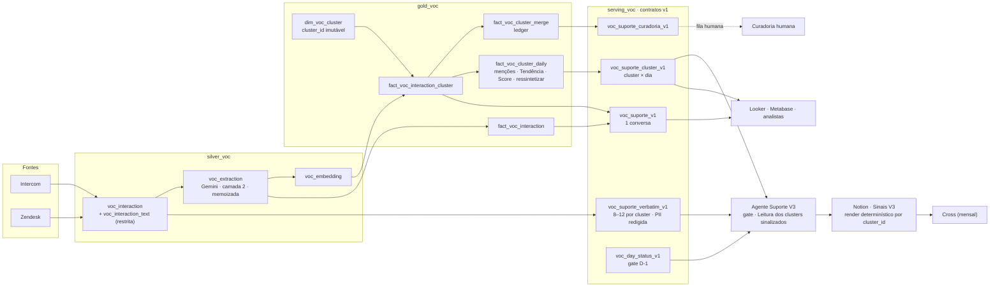

# Proposta — o que embutir na VoC para aliviar o agente de Suporte, e o desenho do Suporte V3

> **Status:** rascunho para revisão · **Data:** 27/10/2026 · **Tipo:** `/propose` (para no plano: nenhum `.sqlx`, prompt ou código escrito)
>
> **Pergunta que a proposta responde.** Com o conteúdo do Suporte V2 absorvido pela VoC, o que pode ser embutido na `dim_voc_full_category` (e nos contratos que a substituem) para tirar o peso de análise de dentro do agente de Suporte? Como fica o agente depois disso (V3)?
>
> **Relação com os outros documentos.** Usa os nomes e as camadas de `propose-voc-generica-e-especialistas.md` (`gold_voc`, `serving_voc`, `voc_suporte_v1`) e `arquitetura-tabelas-voc-dataform.md` (captura idempotente, D-1 íntegro). Reaproveita as medições de `sense-reformulacao-regras-suporte-no-gemini.md`. A própria V2 já previa uma "V3" como a versão de embeddings, com cobertura de 100% e custo constante; esta proposta entrega essa V3 e move o entendimento por item para o data lake.
>
> **Como ler os números.** Tudo que vem dos Logs de Execução [PROD] do Notion é **estimativa dos próprios agentes** (tokens × 6,6e-6 US$), não fatura. Projeções da V3 são aritmética minha sobre esses logs e estão marcadas como estimativa. A seção 7 lista o que não foi verificado.

---

## 0. Resumo

1. **O agente de Suporte V2 gasta a maior parte do orçamento fazendo ETL com LLM.** Nas 3 runs de agosto com quebra por etapa: classificação 45–51% dos tokens, reconciliação 13–34%, síntese da Leitura 18–23%, resto (SQL, Notion, Slack) 9–23%.
2. **Quatro camadas podem sair do agente.** (1) colunas calculadas por SQL e JOIN; (2) colunas geradas pelo Gemini na mesma chamada da VoC; (3) identidade de cluster (embeddings e `cluster_id`); (4) fato diário por cluster com menções, Tendência e Score em SQL. Só as camadas 1 e 2 cabem como colunas. As 3 e 4 precisam de tabelas, o que sustenta a cascata "VoC genérica + especialista".
3. **Efeito estimado:** as camadas 1 a 3 removem 59–68% dos tokens das runs de agosto. A camada 4 elimina a classe de erro de Tendência (9 de 67 runs, em 4 delas 52% dos sinais com ➡ Estável por fallback).
4. **O V3 fica com o que exige julgamento:** a Leitura dos clusters com movimento material e o render no Notion. Estimativa: 110–165 mil tokens por run (≈ US$ 0,7–1,1), contra 430–500 mil nos dias úteis de outubro.
5. **Não embuta as colunas Gemini na `dim_voc_full_category` atual.** Colunas novas no modelo monolítico reclassificam o histórico (~US$ 1,9 mil na medição de 21/10). O caminho é uma extração append-only na `silver_voc`, exposta por `voc_suporte_v1` e pela view de compatibilidade.
6. **Antes de trocar qualquer coisa:** Intercom como fonte da VoC, golden set com eval, teste de estabilidade do `problema_canonico` (o teste dos 3 tickets não rodou por falta de permissão no `AI.GENERATE`) e shadow com o V2 intocado.

---

## 1. Evidências que motivam a proposta

Medido em 27/10/2026 nos bancos "📋 Logs de Execução — Sense [PROD]" e "🤖 Oportunidades — Sense 2.0" do Notion, e no schema de prod da `dim_voc_full_category`.

| # | Achado | Número | Fonte |
|---|---|---|---|
| E1 | Consumo do V2 por etapa | Classificação 45–51% · reconciliação 13–34% · síntese 18–23% · resto 9–23% | Logs de 14/08, 18/08 e 22/08 |
| E2 | Erro de Tendência | **9 de 67 runs (13%)**, no mínimo: 5 com ➡ Estável por fallback, 3 com base aproximada, 1 em branco. Em 4 runs com contagem, 159 de 304 sinais (52%) ficaram sem delta real. 6 das 9 runs fecharam ✅ OK | Corpo dos logs (li 9 dos 67) |
| E3 | Reconciliação e shards | 05–06/08: 472 de 744 classificadas sem reconciliar · 04/09: cobertura de 19% (146/768) · 07/08: fan-out truncou 2 de 3 shards · 22/09: resharding por estouro de output | Logs e prompt do V2 |
| E4 | Duplicatas de cluster sem merge automático | "Status/prazo do chamado" ≈ "Chamado/atendimento: status e prazo sem resolução" (22/10) · "Boleto pago não baixado" × variante (23/09). O Modo B está desabilitado (sem `cluster_id`, sem ledger) | Logs de 22/10 e 23/09 |
| E5 | OPs desfeitas | 3 de 335 (0,9%): 1 arquivada (OP 162, só Suporte) e 2 fundidas (04/10). 334 de 334 OPs ativas estão em "Nova" e não há campo de motivo | Banco de OPs e log do Cross |
| E6 | Ganho do V2 sobre o censo da v1 | Tokens por run: ~1,87 M (v1, 3 runs completas em dev, 28–31/07) → 0,93 M (V2, ago–25/09) → 0,43–0,50 M (desde 26/09): −50% e depois −73% a −77%. Custo: US$ 12,34 → 6,1–6,2 → 2,8–3,3 | Logs dev e prod |
| E7 | Custo mensal do V2 em prod | Set: US$ 114 (único mês completo) · Ago: US$ 67 (desde 14/08) · Out: US$ 52 (até 27/10) | Logs prod |
| E8 | A `dim_voc` não serve o agente hoje | 21 colunas, sem `source = 'intercom'`, sem `customer_type`, sem estado de resolução, `transcription` nula em ~37% dos tickets, quebra de série no insumo do Zendesk | Schema de prod |
| E9 | A versão pré-censo do agente lia a `dim_voc` | Foi trocada por Intercom direto quando o ETL da VoC ficou parado em 23/07, com ~2 dias de atraso | Log dev "Suporte" (julho) |

**Limites dessas evidências.** (a) Custo e tokens são estimativas dos agentes; os logs de outubro dizem "estimativa grosseira", então parte da queda de 26/09 pode ser mudança contábil. (b) A base da v1 são 3 runs. (c) Não há medida de acurácia em nenhuma das versões: o ganho do V2 é de custo e volume. (d) O 9 de E2 é piso: li o corpo de 9 dos 67 logs.

---

## 2. O que embutir na VoC (camadas)

### 2.1 As quatro camadas

| Camada | O que entra | Como | O que tira do agente |
|---|---|---|---|
| **1. Colunas sem LLM** | `source = 'intercom'` com `intercom_conversation_id`; `ai_issue_summary`; `ticket_level` (1 por conversa); `time_to_solved`; `customer_type`; estado de resolução (escalou ou resolveu no chat); canal; `is_noise` (resumo vazio); `ddd_domain` e `ddd_subdomain` por JOIN capacidade → DDD | SQL e JOIN na `silver_voc` e `gold_voc` | Universo do dia, seleção, guard de fan-out do Zendesk, pré-filtro de ruído, deflection, quem fala do dia, leitura do DDD no repositório |
| **2. Colunas Gemini** (mesma chamada `AI.GENERATE`) | `natureza` (8 valores), `postura`, `problema_canonico` (dois grãos: problema específico, ou "Descoberta: feature"), `descoberta_feature`, `evidencia` (até 15 palavras), `curadoria`, `nk_category_id` validada, `extraction_status` | Prompt por fonte, com ~2,3 mil caracteres portáveis do V2 (7,6% do template atual); validação de rótulo em SQL | Classificação (Passo 3) |
| **3. Identidade de cluster** | Embedding do `problema_canonico`; `cluster_id` imutável; vínculo conversa → cluster com método e similaridade; ledger de merge | `VECTOR_SEARCH` contra centróides; alta similaridade atribui sozinho; zona cinza vai a um juiz LLM barato; pool de candidatos clusterizado em batch | Reconciliação (Passo 5), piso de ≥3, Modo A e Modo B de self-merge |
| **4. Fato diário por cluster** | Menções exatas, Acumulado, Pico, Última aparição, % escala, % resolvido, % N2+, tempo de resolução, quem fala mensal, Tendência (dia útil × dia útil), Score e a flag `ressintetizar` | SQL em `fact_voc_cluster_daily` + calendário de feriados | Passos 4 a 6, Baseline/Tendência, Score, série bounded, regras de fim de semana e feriado |

### 2.2 Colunas ou tabelas?

- **Colunas bastam para o entendimento por item** (camadas 1 e 2). Essa é a resposta à dúvida de "colunas extras bastariam?".
- **Tabelas são necessárias para a identidade do problema** (camada 3) e para a contagem por cluster (camada 4). Sem `cluster_id`, o agente continua reconciliando textos livres, e o `COUNT(*)` da `dim_voc` segue sobrecontando (grão interação × categoria, 1,14 linha por item no Zendesk).
- **Onde as colunas moram.** Não na `dim_voc_full_category` atual: colunas Gemini novas no modelo monolítico reclassificam o histórico (~US$ 1,9 mil, medição de 21/10; André falou em ~R$ 3 mil). Elas entram em `silver_voc.voc_extraction` (append-only, chave por conteúdo × prompt × modelo), sobem para `gold_voc.fact_voc_interaction` e são expostas em `serving_voc.voc_suporte_v1`. A view de compatibilidade `dim_voc_full_category` continua com as 21 colunas.

### 2.3 Efeito estimado

| Alavanca | Efeito | Base |
|---|---|---|
| Camadas 1 + 2 | −45% a −51% dos tokens (classificação) | E1 |
| + Camada 3 | −13% a −34% adicionais (reconciliação). Somadas, 59–68% das runs de 18/08 e 22/08 | E1 |
| + Camada 4 | Zera por construção a classe de erro de Tendência, a reconciliação não fechada e o truncamento de shard | E2, E3 |
| 100% da população | Menções exatas: some o ×3,33, o ruído de 15% a 48% de variação em clusters pequenos e médios, e o piso que atrasava o nascimento de problemas com menos de ~8 ocorrências por dia. Ressalva: ~1 em 4 conversas não tem `ai_issue_summary` | Análise de H1 e H2 do V2 |
| Custo de Gemini | Para cobrir 100% das conversas: US$ 14–31 por mês (alternativa "regras no Gemini"), contra ~US$ 146 por mês só de classificação no V2 a 100%. Teste real não executado | `sense-reformulacao-regras-suporte-no-gemini.md` |

### 2.4 Pré-requisitos e riscos das camadas

1. **Intercom na VoC.** A camada 1 depende de `source = 'intercom'`; hoje a tabela só tem Zendesk, NPS, aquisição, Keys-Off, portal de ideias e Reclame Aqui.
2. **Campos que só existem nas tabelas do Zendesk:** `customer_type`, `ticket_level`, `time_to_solved`. Precisam entrar na captura (já previsto em `silver_voc.voc_interaction`).
3. **Verbatins.** A Leitura precisa dos turnos do cliente separados dos do atendente ou do bot, com PII redigida. Não sei se a `transcription` preserva o ator de cada turno.
4. **`ai_issue_summary` corrompido** (perde a substring "ca", desde ≥20/08). A correção é no fluxo do Intercom; a alternativa é o Gemini ler a transcrição, o que muda o insumo.
5. **Vocabulário do `problema_canonico`.** Cada ticket é uma chamada independente; o mesmo problema pode sair com textos diferentes. Risco raciocinado, não medido. A camada 3 (embedding) é a salvaguarda; só com as camadas 1 e 2 a reconciliação volta ao agente.
6. **Quebra de série.** O de-para natureza + postura → `incident_type_gemini` e a data de corte precisam de um ADR.
7. **`dim_ddd_capability` a criar.** A tabela de capacidades DDD hoje vive na página de documentação (`ContaAzul/documentation`); o JOIN exige materializá-la.

---

## 3. Suporte V3

### 3.1 Princípios

1. **O agente deixa de ser ETL.** Não lê Intercom nem Zendesk, não classifica, não reconcilia, não conta e não calcula Tendência. Lê uma publicação fechada e só faz o que exige julgamento.
2. **Idempotência.** O agente lê `available_date = D-1` da `serving_voc` e grava o `nk_publication_id` no log. Reexecutar no mesmo dia lê o mesmo conjunto, e a Leitura é memoizada por `input_hash`.
3. **Fail-closed.** Sem captura fechada de Intercom e Zendesk em D-1, ou com cobertura de extração abaixo do piso, a run aborta sem escrever.
4. **Código no lugar de prompt onde der.** O render no Notion (propriedades, série bounded, toggles) vira script determinístico e testado, não curl montado por LLM.
5. **Isolamento como na V2 sobre a v1.** DB de Sinais e dashboard V3 próprios; V2 fica intocável em paralelo até provar paridade.
6. **Contrato com o Cross inalterado na 1ª fase.** O schema da DB de Sinais no Notion se mantém, para o Cross (mensal) não mudar.

### 3.2 Arquitetura

Nomes seguem o repositório (`fact_` e `dim_`, sem `fct_` nem `bridge_`) e são propostas: o `/build-dataform` os confirma contra as convenções.

### 3.3 Contratos de dados

#### `serving_voc.voc_suporte_v1` (grão: 1 conversa)

| Grupo | Colunas | Camada |
|---|---|---|
| Chaves e tempo | `nk_voc_id`, `intercom_conversation_id`, `nk_zendesk_ticket_id` (nulo se só-bot), `event_date` (BRT), `available_date`, `published_at`, `nk_publication_id`, `is_late_arrival` | 1 |
| Perfil | `nk_company_id`, `customer_type`, `canal`, `ticket_level`, `time_to_solved_h`, `resolution_state`, `is_bot_only` | 1 |
| Qualidade do insumo | `is_noise`, `has_summary`, `extraction_status` (`ok`, `sem_texto`, `indeterminado`, `erro_api`, `invalid_label`) | 1 e 2 |
| Extração Gemini | `natureza`, `postura`, `problema_canonico`, `descoberta_feature`, `evidencia`, `curadoria`, `nk_category_id`, `macro_theme`, `sentiment`, `nk_prompt_version_id` | 2 |
| Domínio | `ddd_domain`, `ddd_subdomain` | 1 (JOIN) |
| Cluster | `cluster_id`, `cluster_method` (`auto`, `juiz`, `humano`), `cluster_similarity` | 3 |

Com 100% da população não há coluna de balde nem de taxa. Se o agente precisar rodar em amostra durante a transição, a coluna `bucket` e o peso `1/taxa` entram como colunas derivadas por `FARM_FINGERPRINT`, sem estado.

#### `serving_voc.voc_suporte_cluster_v1` (grão: cluster × dia)

| Grupo | Colunas |
|---|---|
| Identidade | `cluster_id`, `event_date`, `cluster_nome`, `cluster_descricao`, `ddd_domain`, `ddd_subdomain`, `natureza_dominante` |
| Volume | `mencoes_dia`, `mencoes_dia_util_anterior`, `delta`, `acumulado`, `pico`, `ultima_aparicao`, `mencoes_mes_corrente`, `mencoes_mes_fechado` |
| Deflection e esforço | `pct_escala`, `pct_resolvido_chat`, `pct_n2_mais`, `tempo_resol_h` |
| Quem fala | `p_mes`, `cp_mes`, `cs_mes`, `ni_mes`, `base_parceiro_mes`, `indice_parceiro_mes` |
| Priorização | `tendencia`, `score`, `score_base`, `score_deflection`, `score_complexidade`, `score_esforco`, `score_peso` |
| Orquestração | `is_dormente`, `ressintetizar` (bool), `ressintetizar_motivos` (array) |

#### `serving_voc.voc_suporte_verbatim_v1` e `voc_suporte_curadoria_v1`

- **Verbatim:** por cluster, 8 a 12 turnos de cliente escolhidos por hash determinístico, com PII redigida **no SQL** (CWE-359), restrita por policy tag. O agente deixa de redigir PII.
- **Curadoria:** fila de pares de clusters em zona cinza, conversas com `curadoria = true`, rótulos `invalid_label` e candidatos de merge. O agente só lê e lista; o merge é decisão humana registrada em `fact_voc_cluster_merge` (`source → canonical`).

#### Regras que passam para SQL

| Regra do V2 | Onde fica no V3 |
|---|---|
| Dia útil anterior, sáb/dom e feriados nacionais | `dim_calendario_br` (reutilizar calendário existente, se houver) |
| Tendência: dia útil × dia útil; ponto ausente é zero | `fact_voc_cluster_daily`; sem linha no dia = zero exato, não "gap" |
| Score = Base × Deflection × Complexidade × Esforço × Peso | `fact_voc_cluster_daily`; Peso estratégico vira tabela de regras por domínio e natureza |
| Série bounded (diário, mensal, anual) | Fato diário; a string de render é gerada pelo script |
| Quem fala mensal e Índice parceiro | `fact_voc_cluster_daily`, com `base_parceiro_mes` do Suporte inteiro |
| `RESSINTETIZAR` critérios A1–A5 e B | Coluna `ressintetizar` e `ressintetizar_motivos` |

### 3.4 Fluxo de uma run

| Passo | O que faz | LLM? |
|---|---|---|
| 0. Verificações | Origem do prompt no repositório; allowlist fechada (tabelas `serving_voc.voc_suporte_*`, Notion V3, Slack); sem fallback externo; chave do Notion. A verificação de DDD some (vem por JOIN) | Não |
| 1. Gate | Lê `voc_day_status_v1`: Intercom e Zendesk com captura fechada em D-1 e `extraction_coverage` acima do piso; senão aborta com a mensagem padrão e tenta no próximo agendamento. Grava `nk_publication_id` | Não |
| 2. Delta do dia | Lê `voc_suporte_cluster_v1` de D-1 e a lista de clusters com `ressintetizar = true` | Não |
| 3. Insumo da Leitura | Lê `voc_suporte_verbatim_v1` dos clusters sinalizados | Não |
| 4. Leitura | Escreve a Leitura de 4 partes (o quê, impacto, como está se sentindo, → Cross) para cada cluster sinalizado, em sessão única ou 2 a 3 shards, com barreira de igualdade de conjunto por `cluster_id`. Memoiza por `input_hash`: mesmo insumo, sem nova chamada | **Sim (único)** |
| 5. Curadoria | Lista a fila de `voc_suporte_curadoria_v1` no log e no Radar. Não funde nada | Não |
| 6. Render | Script determinístico faz upsert na DB de Sinais V3 por `cluster_id`: propriedades derivadas, série, `Histórico` e amostra de chamados. Não toca em `Status`, `OP Sense` nem `🔁` | Não |
| 7. Radar e Slack | Números do SQL, texto de template; comentário de uma linha opcional | Opcional |
| 8. Log | Run em "Logs de Execução" com `nk_publication_id`, clusters sinalizados e sintetizados, tamanho da fila de curadoria e **tokens medidos da sessão**, não estimados | Não |

### 3.5 O que sai do V2

| Passo do V2 | Destino no V3 |
|---|---|
| Janela, âncora BRT, `processing_date`, dia útil anterior, feriados | Gate e `dim_calendario_br` |
| 2A/2B/2C: universo, seleção por balde, taxa K/D, knob, enriquecimento, guard de fan-out do Zendesk | Camada 1 |
| Passo 3: clusterização em contexto, prompt canônico, regra do subagente | Camadas 2 e 3 |
| Passo 4: deflection global e por cluster, quem fala do dia | Camada 4 |
| Passo 5: self-merge Modo A e B, piso ≥3 cru, barreira de reconciliação #1 e #2, Score | Camadas 3 e 4 |
| `RESSINTETIZAR` (A1–A5, B) | Coluna `ressintetizar` |
| Passo 6: upsert, série bounded, `Última aparição`, quem fala (virada do mês), corpo | Script de render |
| Passo 7: dashboard e Radar | Render, com números do SQL |
| Passo 8: Slack | Mantém |
| Passo 9: log | Mantém, com tokens medidos |
| Regra do fim de semana, ponto ausente ≠ gap, `❔ Sem base` | Somem: contagem exata e fato diário |
| Fatores de escala ×3,33, estimativa por balde, Score ordinal por amostra | Somem |

### 3.6 Contrato com o Cross e o Notion

- **1ª fase:** o schema da DB de Sinais V3 é idêntico ao da V2, mais uma propriedade `cluster_id` (texto, única). É ela que resolve a identidade que o Modo B não tinha: o nome deixa de ser a chave.
- **Campos humanos** (`Status`, `OP Sense`, `🔁`) continuam do Cross e de pessoas. Um sync devolve esses campos ao BigQuery (`dim_voc_cluster`), para o fato diário e o Cross enxergarem o estado.
- **2ª fase:** o Cross lê `voc_suporte_cluster_v1` direto, e o Notion vira só render.

### 3.6.1 Migração do catálogo da V2

- Cada um dos ~185 sinais do catálogo da V2 recebe um `cluster_id`, gravado nas duas pontas.
- Os centróides iniciais saem da descrição do sinal e de uma amostra de resumos de cada um.
- **Corte de série.** A série da V2 é estimada (amostra escalada por balde) e a da V3 é exata. Segue a política da própria V2 para troca de taxa: rebase, com o ponto de corte anotado. Comparação mês a mês não atravessa o corte.

### 3.7 Orçamento (estimativa)

| Item | V2 hoje (dia útil) | V3 |
|---|---|---|
| Tokens por run | 430–500 mil (out); ~930 mil (ago) | **110–165 mil**: Leitura de ~30 clusters sinalizados × 2,9–4,2 mil tokens (22/08 e 18/08) + 20–40 mil de leitura e escrita |
| Custo por run | US$ 2,8–3,3 | US$ 0,7–1,1 |
| Custo mensal do agente | US$ 114 em setembro | ≈ US$ 15–30 |
| Gemini na VoC (100% de Suporte) | — | US$ 14–31 por mês |
| Embeddings, juiz de zona cinza, reclusterização | — | **Não modelado** |

O total (≈ US$ 30–60 por mês mais a camada 3) não é comparável de forma limpa com o V2: o V3 cobre 100% da população e o V2 amostra 30%. A premissa de 30 clusters sinalizados vem da run de 22/10; o `RESSINTETIZAR` é calibrado em amostra e precisa ser recalibrado com contagens exatas (seção 5).

### 3.8 Duas variantes do V3

| Variante | Quem escreve a Leitura | Quando |
|---|---|---|
| **V3a** | O agente (sessão única, modelo de raciocínio), só para clusters sinalizados | Primeira entrega. A Leitura exige julgamento e leitura de verbatins, e pesa ~20% do consumo atual |
| **V3b** | Job em batch na VoC (`AI.GENERATE` ou API em batch), por cluster com movimento material; o agente deixa de existir e o Notion vira sync determinístico | Destino, depois de eval da Leitura no golden set. Casa com a ideia do Philipi de levar compreensão para o Gemini |

---

## 4. Migração e validação

### 4.1 Fases

Alinhadas às Fases 1 a 3 de `propose-voc-generica-e-especialistas.md`.

| Fase | Escopo | Critério de saída |
|---|---|---|
| 0. Pré-requisitos | Dono da taxonomia e do `voc_prompt`; golden set de 150–200 itens de Suporte; ADR de natureza + postura → `incident_type_gemini`; corrigir o `ai_issue_summary` no fluxo do Intercom; confirmar a permissão do `AI.GENERATE` e rodar o teste dos 3 tickets | Golden set rotulado; teste de estabilidade executado |
| 1. Core com Intercom | `silver_voc.voc_interaction` com Intercom, `customer_type`, `ticket_level`, estado de resolução; camada 1 em `fact_voc_interaction` | Conciliação item a item com o universo atual do V2 (2,1 a 3,0 mil conversas por dia útil) |
| 2. Extração Gemini | Camada 2 em `silver_voc.voc_extraction`, em shadow, por fonte | Eval no golden set ≥ baseline do V2; custo por conversa ≤ US$ 0,0015 |
| 3. Fato diário | `dim_calendario_br`, `fact_voc_cluster_daily` com Tendência e Score em SQL | Replay (4.2) e paridade |
| 4. Clusters | Embeddings, `dim_voc_cluster`, ledger de merge, fila de curadoria; seed a partir do Notion | Top 20 clusters do V2 aparecem em ≥ 80% no V3 na mesma janela (meta do plano); limiares calibrados no golden set |
| 5. Agente V3a em shadow | V3a lendo a `serving_voc`, escrevendo na DB de Sinais V3; V2 em produção | 2 a 4 semanas de paridade; tokens medidos ≤ 200 mil por run |
| 6. Corte | V3 vira produção; V2 fica como fallback intocável; depois desliga | Cross sem diferença de contrato |

### 4.2 Replay das 9 runs com erro de Tendência

As runs de 18/08, 29/08, 05/09, 09/09, 15/09, 22/09, 23/09, 24/09 e 25/09 viram teste de regressão: calcular a Tendência dessas datas no SQL e comparar com o que o V2 gravou. Onde o V2 usou fallback ou base aproximada, a diferença é esperada e deve ser explicada. Onde o V2 tinha baseline real, o SQL deve coincidir.

### 4.3 Métricas

| Métrica | Meta proposta |
|---|---|
| Cobertura de extração `ok` sobre conversas com insumo | ≥ 98% |
| Concordância de `natureza` e categoria com o golden set | ≥ baseline do V2 (a medir) |
| Pureza de cluster (amostra rotulada) | A definir no golden set |
| Runs sem intervenção manual | ≥ 95% |
| Erro de Tendência | 0 por construção; auditado pelo replay |
| Tokens medidos por run (V3a) | ≤ 200 mil |
| Fila de curadoria | Tamanho e idade acompanhados (sem meta inicial) |

---

## 5. Decisões em aberto

| # | Decisão | Opções | Recomendação |
|---|---|---|---|
| 1 | Onde mora a extração Gemini | Colunas na `dim_voc_full_category` ou `silver_voc.voc_extraction` | `silver_voc.voc_extraction`, exposta por `voc_suporte_v1` e pela view de compatibilidade |
| 2 | Limiar diário de Tendência | O prompt do V2 não fixa; o log de 22/10 cita ±10% | Calibrar sobre a série exata; documentar |
| 3 | Recalibrar o `RESSINTETIZAR` | Manter 50% e ≥ 20 menções (calibrado sobre contagem amostrada) ou recalibrar com contagem exata | Recalibrar: sem o ruído da amostra, o limiar muda |
| 4 | Quem escreve a Leitura | V3a (agente) ou V3b (batch na VoC) | V3a primeiro; V3b depois do eval |
| 5 | Quem decide merge de cluster | Humano, juiz LLM com ledger, ou automático | Humano + ledger no início; juiz só na zona cinza |
| 6 | Intercom × Zendesk como grão | Conversa Intercom com tickets filhos (como no V2), ou ticket | Conversa Intercom, com Zendesk como filho |
| 7 | Bots: conversas só-bot | Entram no universo (deflection) ou ficam fora | Entram (denominador do deflection) |
| 8 | Dono do `voc_suporte_v1` | Dados ou Produto | Dados mantêm o core; a área aprova o contrato |
| 9 | Hierarquia no Notion | O HUB de Suporte está sob uma árvore marcada como "legado" (apontado nos logs de 09/09 e 24/09) | Confirmar com o time antes de criar a DB V3 |

---

## 6. Riscos

| Risco | Impacto | Mitigação |
|---|---|---|
| Vocabulário instável do `problema_canonico` | Clusters partidos ou duplicados | Camada 3 por embedding; teste dos 3 tickets; ledger e fila de curadoria |
| Limiares de similaridade mal calibrados | Atribuições erradas ou pool inflado | Calibrar no golden set; zona cinza ao juiz |
| Drift dos centróides | Clusters antigos absorvem tema novo | Reavaliação periódica; log de método e similaridade |
| Conversas sem `ai_issue_summary` (~1 em 4) | Cobertura abaixo de 100% mesmo sem amostra | Gemini lê a transcrição ou o `message_body`; medir cobertura real |
| Verbatins sem separação de ator | Leitura pior ou PII vazada | Validar a estrutura da `transcription`; redigir PII no SQL |
| Custo de camada 3 não modelado | O orçamento total pode subir | Modelar com a calibração da Fase 4 |
| Corte de série (estimada → exata) | Tendência histórica muda de nível | Rebase anotado; sem comparação através do corte |
| Notion sem compare-and-set | Conflito em escrita concorrente | `cluster_id` único + run diária + `Run now` fora da janela |
| Troca de taxonomia e separação de status | Quebra de série | Semente `legacy` e ADR com data de corte |
| Custos e tokens são estimativas | Metas mal ancoradas | Passar a registrar tokens medidos no log |

---

## 7. Premissas e o que não foi verificado

- **Custo e tokens** dos logs são estimativas dos agentes (tokens × 6,6e-6 US$). Os de outubro são "estimativa grosseira"; a queda de 26/09 pode misturar economia real e mudança contábil.
- **Quebra por etapa** (E1) existe só para 3 runs de agosto (14/08, 18/08 e 22/08); a de 14/08 não separa a síntese.
- **Base da v1** (E6): 3 runs completas em dev. A estreia de 28/07 registrou 283 mil tokens, claramente subcontada, e ficou fora.
- **Erros de Tendência (E2):** li o corpo de 9 dos 67 logs, o resumo de todos, e acompanhei trechos de mais 3 por busca; 9 é piso.
- **OPs desfeitas (E5):** só no banco "Oportunidades — Sense 2.0", onde todas as OPs estão em "Nova". Se a triagem acontece em outro board, os descartes reais estão lá; não verifiquei.
- **Projeções do V3** (seção 3.7) são aritmética sobre os logs, com 30 clusters sinalizados por dia como premissa.
- **Camada 3** (embeddings, juiz, reclusterização) não foi modelada em custo nem testada.
- **Teste dos 3 tickets:** não executado (`AI.GENERATE` sem permissão); a estabilidade do `problema_canonico` por ticket é desconhecida.
- **`dim_ddd_capability`, `dim_calendario_br` e `fact_voc_cluster_*`** são propostas; não verifiquei se existem ou conflitam com modelos do repositório.
- **Nomes de tabelas** seguem a convenção observada no repositório, mas o `/build-dataform` deve confirmá-los.
